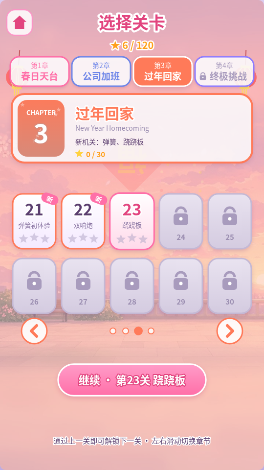
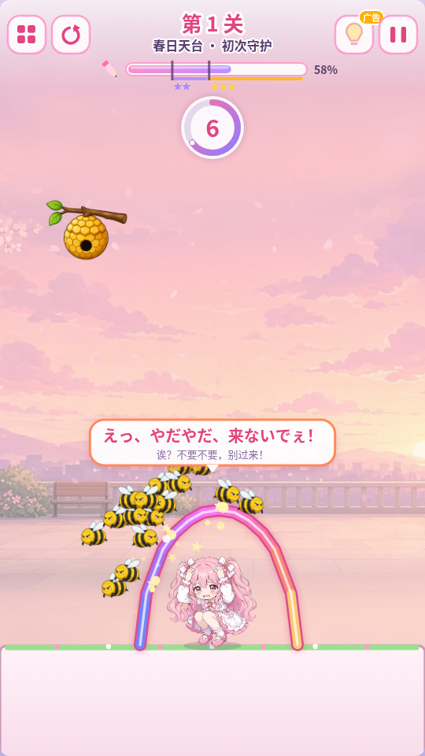
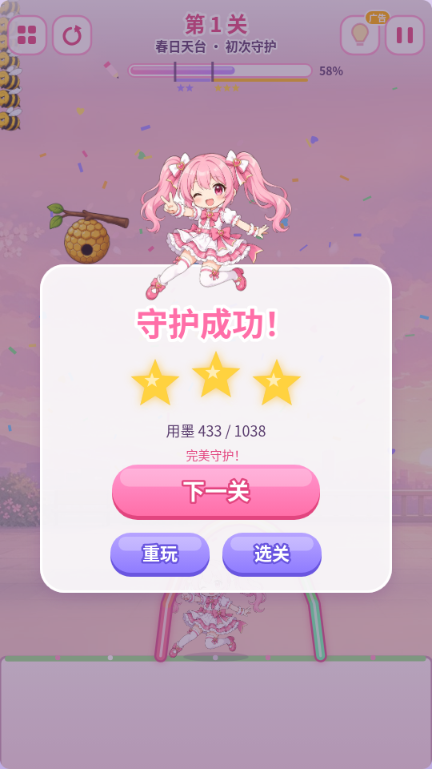
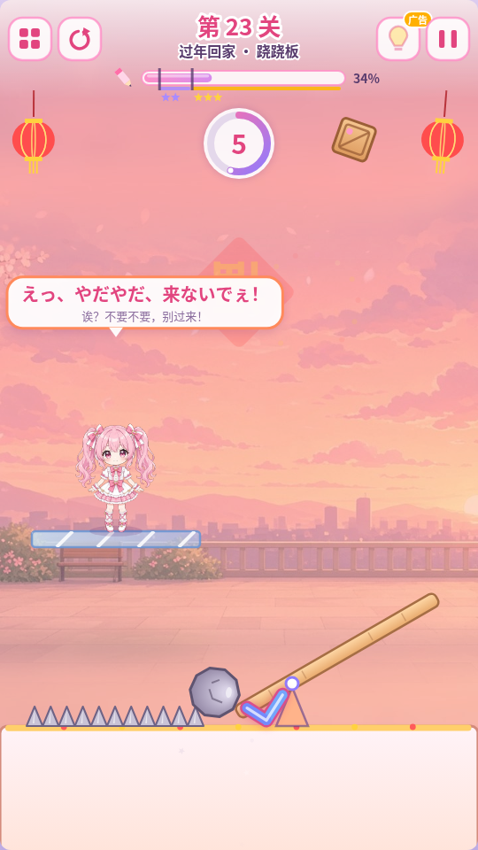
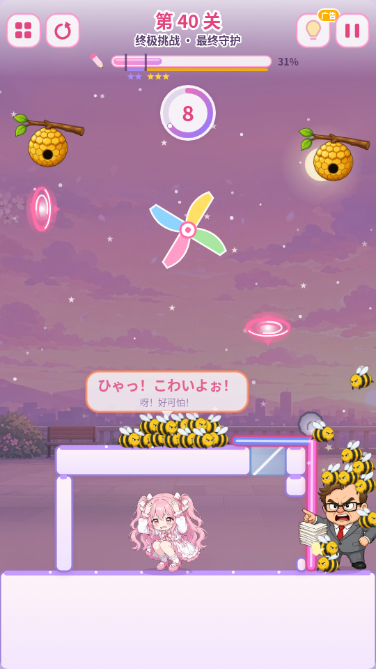
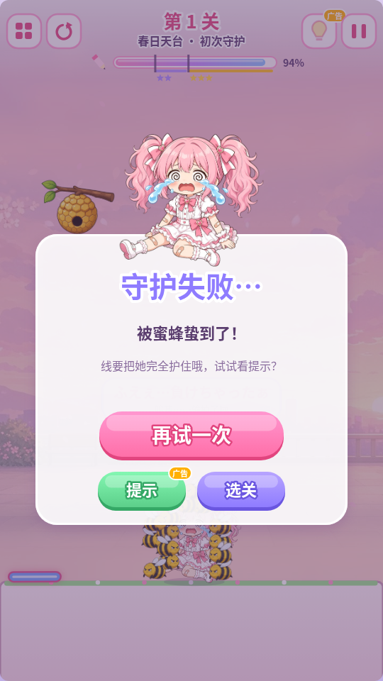

# 《画线守护美少女》AnimeDrawLine

**出品：狸猫** · v1.5.0 · 网页版 / Windows 桌面版 / 抖音小游戏版 / 微信小游戏版（同一份玩法代码）

一款"画线救小狗 / Save the Doge"玩法的 2D 物理画线解谜小游戏：粉色双马尾少女被蜜蜂、加班老板、催婚亲戚和落石围攻，你只能**画一笔**线把她护住——松手后线会变成受重力影响的刚体，坚持到倒计时结束就算守护成功！

- 技术栈：纯 HTML5 Canvas + JavaScript (ES Modules) + [Matter.js](https://brm.io/matter-js/) 物理引擎（与姊妹项目《美少女合成》AnimeMerge 同一套架构）
- 完全离线：Matter.js 已放在 `vendor/`，音效由 WebAudio 实时合成，主角语音为 **AivisSpeech（リダ / Lida）** 预生成的 mp3，背景音乐为原创程序化作曲《棉花糖散步》
- **40 个手工关卡，分 4 章**（春日天台 / 公司加班 / 过年回家 / 终极挑战），每章有自己的背景色调与程序绘制的主题装饰；选关界面按章节分页
- **1.3：每关一个关键点**。从第 4 关起，直接在主角身上画个罩子基本过不了（通用罩子胜率 97% → 20%，三星率 91% → 3%），要找到这一关真正该堵的门、该盖的天窗、该托住的地板
- **8 种可配置机关**：移动平台 / 电梯、跷跷板、木箱、成对传送门、弹簧、易碎玻璃、风车、禁画区，以及浮岛、楼梯、悬挑、走廊、隔墙等多层地形
- 每关按用墨量评 1~3 星（1.3 起三星还要求线和她保持一点距离），星级与解锁进度存到 `localStorage`（自动迁移旧版本存档）
- 提示功能（参考解法虚线），预留「看激励视频解锁提示」的广告接口（`AdService`，可直接接抖音小游戏）
- 主角会根据局势切换表情（平静 → 害怕 → 开心 / 哭泣），并说出甜甜的日语台词（语音 + 日中双语字幕）
- 竖屏 9:16，自动适配窗口；支持鼠标、触屏和键盘
- **1.4：抖音小游戏版**（`douyin/`，用抖音开发者工具直接打开）：平台抽象层 `src/platform/`、分包、预渲染音效、激励视频、录屏分享、侧边栏复访；上架步骤见 [`douyin/上架说明.md`](../douyin/上架说明.md)
- **1.5：微信小游戏版**（`wechat/`，用微信开发者工具直接打开）：`wx.*` 平台层、分包、激励视频、转发 + 分享到朋友圈；上架步骤见 [`wechat/微信上架说明.md`](../wechat/微信上架说明.md)。主角语音换成 **リダ / Lida**（作者许可允许法人商用、只需署名，无需事先联系）

| 主菜单 | 选关 (章节页签) | 关卡中 | 胜利 |
| --- | --- | --- | --- |
|  |  |  |  |

| 第 3 章「过年回家」(跷跷板把木箱弹起) | 第 4 章「终极挑战」最终关 (电梯+风车+传送门+弹簧) | 失败 |
| --- | --- | --- |
|  |  |  |

---

> 本文档面向开发者。玩家请看仓库首页 [README](../README.md)：到 Releases 下载 zip、解压、双击即可玩。

## 〇、快速构建 / 测试 / 发布

需要 Node.js 18+（推荐 20+）；预渲染音效 / 素材脚本另需 Python 3 + Pillow、ffmpeg。

```bash
npm install                       # 安装依赖 (esbuild / matter-js / electron 等)

# 网页版 -> dist/ (双击 dist/index.html 或 npm run serve)
npm run build

# Windows 桌面版 (Electron) -> release/画线守护美少女/画线守护美少女.exe
npm run package:win               # Linux 版：npm run package:linux

# 抖音小游戏 -> douyin/ (用抖音开发者工具打开 douyin/)
node tools/render-sfx.mjs         # 仅在改了合成音效后需要 (assets/sfx/ 已提交)
npm run build:douyin

# 微信小游戏 -> wechat/ (用微信开发者工具打开 wechat/)
npm run build:wechat
```

```bash
npx playwright install chromium   # 首次
npm run build && npm test         # 关卡可解性 + 物理审计 + 浏览器测试
npm run test:douyin               # 抖音版 (模拟 tt)
npm run test:wechat               # 微信版 (模拟 wx)
npm run package:linux && xvfb-run -a node tools/test-desktop.mjs   # 桌面版
```

`douyin/` 与 `wechat/` 已包含构建好的工程，可以直接用对应的开发者工具导入；上架前只需改各自的 `config.js`（`APPID` / `AD_UNIT_ID`，留空时游戏里不显示任何广告界面）。上架步骤：[`douyin/上架说明.md`](../douyin/上架说明.md)、[`wechat/微信上架说明.md`](../wechat/微信上架说明.md)。（目前发行渠道只用 GitHub Releases，小游戏工程仅作保留。）

**GitHub 发布**：Releases 里放两个 zip——`huaxian-shouhu-windows.zip`（顶层文件夹 `画线守护美少女/`：完整 Electron 程序 + `怎么玩.txt`）和 `huaxian-shouhu-web.zip`（顶层文件夹 `画线守护美少女-网页版/`：`dist/` 内容 + `怎么玩.txt`，双击 `index.html` 离线可玩）。zip 用 Python `zipfile` 生成（自动写入 UTF-8 文件名标志，Windows 资源管理器 / 7-Zip 解压中文名不乱码）。

## 一、如何运行

### 方式 0：Windows 桌面版（exe）
打开 `release/画线守护美少女/画线守护美少女.exe` 即可（Electron 打包，无需安装、无控制台窗口；整个 `画线守护美少女` 文件夹需要一起拷贝）。
- 竖屏 9:16 窗口，可拖动缩放；单实例（重复双击只会激活已打开的窗口）；无菜单栏、禁用开发者工具
- 存档保存在 `%APPDATA%\AnimeDrawLine`，重启 / 升级后保留
- 桌面版启动即播放背景音乐和语音（不需要先点击）

### 方式 1：双击直接玩（最简单）
打开 `dist/index.html` 即可（已打包成单个经典脚本，`file://` 下不会有跨域问题）。

### 方式 2：双击 `start.bat`（推荐）
- 检测到 **Python** → 用 `python -m http.server` 启动本地服务器并自动打开浏览器
- 否则检测到 **Node.js** → 用 `node tools/serve.js` 启动服务器
- 都没有 → 直接用浏览器打开 `dist/index.html`

服务器地址：<http://localhost:8766/dist/index.html>（端口与《美少女合成》的 8765 错开，两个游戏可同时运行），关闭弹出的 "AnimeDrawLine Server" 窗口即可停止服务。

### 方式 3：开发模式（修改源码时）
需要 Node.js 18+：
```bash
npm install          # 安装 esbuild / matter-js / playwright (仅开发需要)
npm run build        # 打包 src/ -> dist/
npm run serve        # 启动本地服务器 http://localhost:8766/
```
- `http://localhost:8766/index.html`：**开发版**，直接加载 `src/` 下的 ES 模块源码（改完刷新即可，必须通过服务器访问）
- `http://localhost:8766/dist/index.html`：**发布版**，修改源码后需重新 `npm run build`

### 打包桌面版（Electron）
```bash
npm run package:win     # -> release/画线守护美少女/画线守护美少女.exe (Windows x64，在 Linux 上也能打包)
npm run package:linux   # -> build/linux-x64/ (仅用于自动化测试)
npm run desktop         # 开发时直接用 Electron 运行
```
`tools/package.mjs`：构建 dist → 组装最小应用目录（`desktop/main.js` + `dist/` + package.json）→ `@electron/packager` 打包成 `resources/app.asar` → `tools/win-resources.mjs` 用 resedit（纯 JS，无需 wine）写入 `assets/icons/app.ico` 图标与中文版本信息（产品名「画线守护美少女」、公司「狸猫」、版权「Copyright © 2026 狸猫 (出品：狸猫)」、版本号）。Electron 的 exe 是 Windows GUI 子系统，不会弹出控制台窗口。
**增量更新**：只改了游戏内容时，只需替换 `release/画线守护美少女/resources/app.asar`（约 5 MB）。

### 自动化测试
```bash
npx playwright install chromium   # 首次需要
npm run build && npm test
```
`npm test` 包含关卡验证、物理审计和浏览器测试（桌面版另有第 3 部分）：
1. **关卡可解性验证** `node tools/verify_levels.mjs`（无浏览器，直接在 Node 里跑关卡模拟 `LevelWorld`，十几秒跑完 40 关，`node tools/verify_levels.mjs 23 37 --seeds=10` 可只验证指定关卡）：
   - 用每关配置里的参考解法 `solution`，走与玩家**完全相同**的画线检测（不能穿过主角/敌人/地形、墨水够用），再用多个随机种子（默认 5 个）模拟整段倒计时，必须全部胜利
   - 「手抖」测试：解法的每个点随机偏移 ±4 像素，3 个变体至少 2 个要胜利（保证解法不是靠像素级精度）
   - 对照组：只画一条无用的短线，主角必须失败（保证关卡确实有威胁）
   - 参考解法必须拿到 3 星
   - 通用罩子（1.3）：每关输出 12 种罩子的胜率和三星率；全量运行时断言第 4 关起平均胜率 ≤ 25%、三星率 ≤ 5%（`--no-dome` 跳过）
2. **浏览器冒烟测试** `node tools/test.mjs`（Playwright 无头 Chromium）：`dist` 双击版加载无报错、10 张图片 + 15 条语音加载、菜单 → 选关 → 第 1 关、锁定关卡不可进入、线不能穿过主角、**真实鼠标拖动**画出罩子 → 线成形 → 蜜蜂撞线弹开 → 最后 3 秒滴答 → 胜利三星 + 三星语音 + 存档 + 解锁第 2 关、暂停停表、失败流程（哭泣表情 + 失败语音 + 失败面板）、失败面板「提示」→ 桩广告 → 重开并显示参考线；**声音**：语音 mp3 实际播放、BGM 在第一次点击后开始并跨场景连续播放、播放到结尾无缝循环、台词时 BGM 闪避、默认音量、旧存档大音量被丢弃、重试时开场白按概率省略、「害怕」每次挑战最多一次、蜂群只有一个低音量嗡嗡声、菜单「制作人员」面板与音乐开关；**旧版 v1 存档迁移**、章节页签 / 箭头 / 滑动 / 键盘翻页、锁定章节、从第 3 章进入第 23 关（跷跷板）和从第 4 章进入第 40 关（全机关）并用参考解法通关；开发版源码可运行（含章节切换和第 28、36 关的机关）。两种方式都检查控制台无错误；另外检查**音量设置面板**（菜单 + 暂停面板，拖动总音量滑块后各声道音量按比例变化并保存）。截图保存到 `docs/screenshot-*.png`（`node tools/test.mjs <目录>` 可另存一份）。

3. **桌面版测试** `npm run package:linux && xvfb-run -a node tools/test-desktop.mjs`：在 Linux 上运行同一份打包应用，检查打包模式、窗口标题、无菜单栏、9:16、无法打开开发者工具、存档目录 `…/AnimeDrawLine`、从 `app.asar` 加载、图片 / 语音加载、启动即播放 BGM 并循环、用鼠标画线通关第 1 关、单实例锁、重启后进度和音量设置保留、控制台无错误。

4. **物理与规则审计测试** `node tools/test_physics.mjs [--only=tunnel,draw,timing,platform,dome,save]`（Node，几秒跑完，已加入 `npm test`）：
   - 穿透：石头 / 滚石 / 文件 / 爱心照片 / 蜜蜂 / 木箱以 8~70 px/帧、0° 和 35° 射向画的线和 18px 薄地形，一个都不能穿过（`--no-cap` 关闭防穿透做对照：修复前全部穿过）
   - 画线：在主角身上按下 → 拖出来才开始画；零长度 / 过短的线取消且不占用「一笔」；松手后不能画第二笔；400 步乱涂的墨水消耗 = 折线长度（误差 < 1e-6）且不超过上限；乱涂的每一段都不穿过主角 / 风车 / 禁画区 / 地形；自交乱涂和 3000px 五圈螺旋落地后不抖动；V 字尖角不漏石头；取消（暂停 / 失焦）不扣墨水
   - 胜负：只结算一次；自己画的线砸到主角不算失败；高速木箱砸到算失败；主角被撞出屏幕干净地失败一次
   - 移动平台：两腿垂在平台外侧的线会被带着走
   - 罩子（1.3）：第 7、16、34 关贴着她画的罩子大多只有 2 星；第 1 关罩子照样 3 星；第 4、18、27、39 关参考解法 3 星
   - 存档：v1 → v4、v2 → v4、v3 → v4 迁移（第 4~40 关星级 / 最少用墨清零、解锁和提示保留、「新」标记）、已是 v4 的存档不会再次清零、主存档损坏从备份恢复、主存档和备份都坏了不崩溃
5. **手残玩家机器人** `node tools/sloppy_bot.mjs [关卡号...] [--json=out.json]`：每关 16 次「手抖版参考解法」（整体偏移 ±12px、缩放 0.92~1.08、每 7px 加 σ=6px 的漂移）+ 12 次「通用罩子」，报告每关手抖通过率、罩子胜率、罩子三星率与失败原因，最后给出第 4 关起的汇总（结果见 `docs/sloppy-bot-v13.json`，1.2 对照见 `docs/sloppy-bot-v12.json`）。`node tools/inspect_level.mjs <关> [solution|shaky:i|dome:i]` 可查看单次画线的结果和线的位置变化。

### 1.5 换声（リダ）+ 微信小游戏版 + GitHub

**主角语音换成 リダ / Lida**：まお 的权利方（株式会社Trippy）的二次创作指南要求「法人または営利事業者」事先联系，本作发行方是公司，所以换成作者许可明确允许商用、只要求署名（「リダ」或「Lida」+ https://youtube.com/channel/UC2tX473Zo09ZCnhAUNdAvjA/join）、无需事先联系的 **リダ / Lida（感情表現模型）**。许可原文已在 AivisHub 模型清单（作者本人发布）上逐字核对，全文见 `docs/licenses/Lida-voice-model.txt`。另一个候选 黄金笑_T2（Tαkoe 项目规约，同样允许法人商用、只需著作权表示）试听后表现力较弱（同句音高起伏 7~8 半音，リダ 10~12 半音；リダ 有 キュート 风格），且原始规约站点 wedst.pj.ymhk.jp 当天无法访问、只能看到 AivisHub 上的转载，所以选 リダ。15 句全部用同一流程重新生成（自己的 AivisSpeech 实例、8 个候选、Whisper 筛选、最有感情、≈1.2 倍速、−20 LUFS）；制作人员面板、README、`docs/licenses/`、Electron「关于」、抖音 / 微信版头注释与许可目录、隐私协议草稿同步更新，まお 的 ACML 文件已移除。

**微信小游戏版**（`wechat/`）：`src/platform/MiniGamePlatform.js` 抽出抖音 / 微信共用的小游戏平台层（画布、图片、InnerAudioContext、BGM 两路交替无缝循环、触摸、存储、生命周期、安全区、分包、激励视频、`AD_UNIT_ID` 为空时隐藏所有看广告界面），`DouyinPlatform` 只保留录屏 / 侧边栏 / 抖音分享，新增 `WeChatPlatform`（`wx.getWindowInfo` 安全区、转发 + 分享到朋友圈、无录屏 / 侧边栏）。构建逻辑合并到 `tools/lib/minigame-build.mjs`（`build-douyin.mjs` / `build-wechat.mjs` 是两个入口）。见「十、微信小游戏版」。

**启动页《健康游戏忠告》**：小游戏审核要求游戏开始画面全文登载《健康游戏忠告》（微信常见拒绝情形 3.6.6），启动页底部已加上；软著登记号 / 出版物号填在 `GameConfig.copyrightRegNo` / `publicationNo` 后会显示在忠告下方。小游戏版启动页至少停留 1.5 秒。

**GitHub**：源码在 `limoaCatherine/anime-minigames` 的 `games/huaxian`。`.gitignore` 排除 node_modules、dist、build、release、打包产物、语音候选 take、密钥，以及可重新构建的抖音/微信包体。

### 1.4 出品署名 + 抖音小游戏版

**出品署名**：所有对外显示的署名统一为「出品：狸猫」——启动加载画面底部、主菜单标题下方、「制作人员」面板、本 README、exe 版本信息（CompanyName「狸猫」、LegalCopyright「Copyright © 2026 狸猫 (出品：狸猫)」）、package.json（author「狸猫」、productName「画线守护美少女」）、Electron「关于」面板（`app.setAboutPanelOptions`）、抖音版的 game.js 头注释与制作人员面板。游戏内显示的出品方名称取自 `src/config/GameConfig.js` 的 `publisher`（打包脚本 `tools/package.mjs`、`desktop/main.js` 和抖音构建头注释里也写了「狸猫」）。Windows 的 AppUserModelID / appId 仍是 `com.gamel.animedrawline`（只是内部标识，改了会让已固定到任务栏的快捷方式失效，所以保留）。

**平台抽象层** `src/platform/`：玩法代码不再直接访问 `window` / `document` / `localStorage` / `Image` / `Audio` / `AudioContext`，全部经由当前平台对象：
- `WebPlatform`（浏览器）、`ElectronPlatform`（桌面版，按 UA 自动识别）、`DouyinPlatform`（`tt.*`）；接口说明见 `src/platform/Platform.js`
- 画布 / 图片 / 资源路径、音频（抖音用 `TTAudio` 把 InnerAudioContext 包装成 HTMLAudio 的外观）、存储、时间与帧循环、屏幕尺寸与安全区、切后台、触摸输入、激励视频、分享
- `Game` 支持「全屏画布 + 安全区内居中 letterbox」（抖音）和「画布本身缩放」（网页）两种布局，触点统一用 `game.toLogical()` 换算
- 网页构建用 `src/platform/current.js`；抖音构建在 esbuild 里把它换成 `current.douyin.js`，并把 `src/lib/matter.js` 换成 npm 的 matter-js

**音效后端**：没有 WebAudio 的平台使用 `SfxSampler`（`src/systems/SfxSampler.js`）。`tools/render-sfx.mjs` 在无头 Chromium 的 OfflineAudioContext 里用 `AudioSystem.synth()` **同一份合成代码**离线渲染 33 个音效（画笔音按墨量分 3 档、蜜蜂撞线 4 个音高、星星 3 个、最后一秒滴答等变体），归一化后编码成 22 kHz 48 kbps mp3（共约 77 KB），清单里记录原始峰值，播放音量 = 声道音量 × 原始峰值，响度与网页版一致；蜂群嗡嗡声在 Node 里按同样的参数合成一段 8/3 秒、所有频率首尾相位闭合的无缝循环 wav，音量每帧平滑。限频、静音、声道音量、BGM 台词闪避都与网页版共用。

**广告接口**与《美少女合成》统一：`ads.showRewardedAd(placement) -> Promise<boolean>`、`ads.setProvider(fn)`、`ads.stats`；旧的 `showRewarded()` 保留为兼容包装。

**抖音小游戏版**（`douyin/`，`node tools/build-douyin.mjs` 生成）：见下方「九、抖音小游戏版」。

### 1.3 关卡重新设计：罩子不再通吃

**问题**：1.2 里，在主角身上随手画个罩子能通过 39/40 关，而且几乎都是三星（第 4 关起：通用罩子胜率 97%、三星率 91%）。

**做法**：第 1~3 关保留为教学关（罩子就是正确答案）。第 4~40 关全部重新设计，每关只有一个关键位置：

- **威胁从罩子挡不住的方向来**：天窗 / 门洞在离她较远的地方，蜜蜂、石头、文件从那里进来。屋顶很矮，罩子放不下，只能画成贴在她身边的一截
- **堵门**（第 5、6、11、13、24、27、33、34、37、38 关）：门框 = 门楣 + 门槛。线要靠在门框**外面**，L 形的脚朝外，被推时会压紧门框，不会倒进门里
- **盖天窗 / 缝隙**（第 4、9、14、19、21、22、26、29、31、35 关）：盖住屋顶上的缺口，两端搭在屋顶上
- **会塌的地板**（第 12、25 关）：玻璃地板到点碎裂（新增 `glass.breakAt`，碎前会抖动、裂纹变红），要提前在下面兜一根线
- **托住 / 卡住**：第 7、16 关卡住冲过来的老板；第 15、28、32、36 关在禁画区下方的钉子或搁板上搭横梁
- **Γ 钩**（第 20、30、40 关）：一笔同时盖住天窗、挡住门
- **墨水与星级**：墨水上限 = 解法长度 × 1.6~1.45（第 1~3 关 2.4），三星 / 二星 = 解法长度 × 1.15 / 1.45（第 1~3 关 1.3 / 1.8）
- **三星间距**：三星还要求线和她的距离 ≥ 参考解法间距 × 0.65（最多 40px；第 1~3 关和第 18 关不要求）。贴着她画的罩子即使过关也最多 2 星，结算面板会提示「线贴得离她太近啦」
- **墨水条**：星级刻度加粗、伸出墨水条；墨水条下方的色带标出三星区（金）和二星区（紫）；星星画在墨水条下方，丢掉的星变灰并画斜线
- **画线手感**：落笔点稍微按进地面或障碍物里（≤ 18px）时，从最近的表面开始画；老板被挡住后不会再被静摩擦卡死

**测量方法**（`node tools/sloppy_bot.mjs`；`node tools/verify_levels.mjs` 也会输出罩子数据）：

- 手抖解法：每关 16 次，参考解法整体偏移 ±12px、以这一笔自己的中心缩放 0.92~1.08、每 7px 加 σ=6px 漂移
- 通用罩子：每关 12 种，不看关卡，在她身上画半椭圆或方顶罩子，比她宽 16~58px、高 14~42px，一半从左脚开始画、一半从右脚开始画
- 1.2 数据是用同一套机器人在 1.2 源码上重新测的（`docs/sloppy-bot-v12.json`），1.3 数据见 `docs/sloppy-bot-v13.json`

| 关 | 名称 (1.3) | 手抖解法 1.2 → 1.3 | 通用罩子胜率 1.2 → 1.3 | 罩子三星 1.2 → 1.3 |
| --- | --- | --- | --- | --- |
| 1 | 初次守护 | 100% → **100%** | 100% → **100%** | 100% → **100%** |
| 2 | 墙角的约定 | 94% → **100%** | 92% → **100%** | 92% → **100%** |
| 3 | 天台高处 | 100% → **100%** | 100% → **100%** | 100% → **100%** |
| 4 | 盖上盖子 | 88% → **100%** | 100% → **8%** | 0% → **0%** |
| 5 | 关好门 | 100% → **100%** | 100% → **17%** | 100% → **17%** |
| 6 | 加班老板来了 | 100% → **94%** | 100% → **8%** | 100% → **0%** |
| 7 | 下班别想走 | 100% → **100%** | 100% → **50%** | 100% → **8%** |
| 8 | 老板与蜂群 | 100% → **100%** | 100% → **0%** | 100% → **0%** |
| 9 | 催婚亲戚 | 100% → **94%** | 100% → **0%** | 100% → **0%** |
| 10 | 木箱帮帮忙 | 100% → **94%** | 100% → **50%** | 100% → **17%** |
| 11 | 电梯上班 | 100% → **88%** | 100% → **33%** | 100% → **0%** |
| 12 | 地板要塌了 | 100% → **100%** | 100% → **8%** | 100% → **0%** |
| 13 | 楼梯滚石 | 100% → **100%** | 100% → **25%** | 100% → **17%** |
| 14 | 移动工位 | 100% → **88%** | 100% → **0%** | 100% → **0%** |
| 15 | 禁止涂鸦 | 100% → **94%** | 100% → **0%** | 100% → **0%** |
| 16 | 玻璃隔断 | 100% → **100%** | 100% → **58%** | 100% → **8%** |
| 17 | 午休相亲 | 100% → **100%** | 100% → **50%** | 100% → **0%** |
| 18 | 撑住走廊 | 69% → **100%** | 0% → **0%** | 0% → **0%** |
| 19 | 会议室 | 100% → **88%** | 100% → **17%** | 8% → **0%** |
| 20 | 加班风暴 | 100% → **88%** | 100% → **17%** | 100% → **8%** |
| 21 | 弹簧初体验 | 100% → **100%** | 100% → **50%** | 100% → **0%** |
| 22 | 双响炮 | 100% → **88%** | 100% → **8%** | 100% → **0%** |
| 23 | 跷跷板 | 94% → **88%** | 100% → **33%** | 100% → **0%** |
| 24 | 鞭炮弹弹弹 | 100% → **94%** | 100% → **8%** | 100% → **0%** |
| 25 | 阿姨落地 | 94% → **100%** | 100% → **8%** | 100% → **0%** |
| 26 | 回家的路 | 100% → **100%** | 100% → **50%** | 100% → **0%** |
| 27 | 团圆饭桌 | 56% → **94%** | 100% → **17%** | 75% → **0%** |
| 28 | 玻璃花房 | 100% → **100%** | 100% → **0%** | 100% → **0%** |
| 29 | 双跷跷板 | 100% → **100%** | 100% → **0%** | 100% → **0%** |
| 30 | 过年大团圆 | 100% → **88%** | 100% → **8%** | 100% → **0%** |
| 31 | 任意门 | 100% → **100%** | 100% → **50%** | 100% → **8%** |
| 32 | 风车转转 | 100% → **100%** | 100% → **25%** | 100% → **0%** |
| 33 | 传送落石 | 100% → **94%** | 100% → **25%** | 100% → **8%** |
| 34 | 加班传送门 | 100% → **100%** | 100% → **50%** | 100% → **8%** |
| 35 | 移动的家 | 100% → **100%** | 100% → **0%** | 100% → **0%** |
| 36 | 弹射传送 | 100% → **94%** | 100% → **17%** | 100% → **8%** |
| 37 | 风车阵 | 100% → **88%** | 100% → **0%** | 100% → **0%** |
| 38 | 木箱快递 | 100% → **100%** | 100% → **42%** | 100% → **8%** |
| 39 | 地下来客 | 100% → **100%** | 100% → **0%** | 100% → **0%** |
| 40 | 最终守护 | 100% → **94%** | 100% → **0%** | 100% → **0%** |
| **第 4~40 关平均** | | 97% → **96%** | 97% → **20%** | 91% → **3%** |

- **第 18 关「撑住走廊」**：1.2 的解法（在走廊里撑一根线）手抖通过率只有 69%。1.3 改成封住矮走廊入口的地面，入口只有约 30px 高：手抖 **100%**，罩子 0%。入口就在她身边，所以这一关不要求三星间距
- **第 27 关「团圆饭桌」**：1.2 的「门帘」挂在桌边会滑落或被石头打翻，手抖只有 56%。1.3 在桌边加了门楣和门槛，只留一个小门洞，从外面用 L 形线堵上：手抖 **94%**，罩子 17%（三星 17%）
- **还剩的问题**：第 7、10、16、17、21、26、31、34 关仍有约一半的罩子能过关。原因是屋顶下被截断的罩子变成了她身边的一根柱子，正好挡住侧面来的东西。这些罩子因为间距不够只能拿 2 星。罩子三星率不为 0 的关卡：第 10、13、27 关 17%，第 7、16、31、33、34、38 关 8%，都是罩子画得比较大、离她足够远的情况

### 1.2 自查修复（审计结果）

**Bug 修复**
- **高速物体穿透**：Matter.js 没有连续碰撞检测，速度 ≥ 22 px/帧的石头 / 文件 / 蜜蜂 / 木箱会直接穿过 14px 的线或 18px 的薄地形。现在每个物理步前按「物体最薄半径 + 挡板半厚」给每个刚体限速（`GameConfig.physics.antiTunnel`），正常速度不受影响
- **画到一半暂停 / 切后台**：以前会把半截线直接提交并让状态机错乱；现在这一笔作废，继续后重新画
- **窗口失焦 / 指针被系统收回**：以前 pointerup 丢失后指针一直被占用，之后所有点击都被当成「第二根手指」忽略（无法画线 / 点按钮）；现在自动释放，这一笔作废
- **「待落笔」在游戏里不生效**：按在不能画的地方后拖出来，线应从第一个合法位置开始；以前只在测试工具里有效
- **画线手感过严**：手指稍微按进地面 / 擦过障碍物边角时线会卡死或整笔作废（手残玩家机器人 48% 的失败都是这个）。现在笔尖会贴着表面走（≤18px），擦到主角 / 障碍物边角时自动从外侧绕过去
- **蜂群把线推走**：蜜蜂撞线后会短暂弹开（`recoil`），不再一群蜂把轻的罩子顶出 90px
- **移动平台带不动宽线**：两端垂在平台外侧的线以前会从平台上滑下去；现在按重心判断是否「站在平台上」
- **提示看广告是异步的**：看广告期间换关 / 退出，回来后会重开错误的关卡、解锁错误关卡的提示；现在只对发起请求的那次挑战生效
- **广告播放时** BGM 继续播放、台词继续说：现在广告期间 BGM 暂停、语音停止
- **存档损坏**：以前直接丢失全部进度；现在从备份恢复
- **桌面版刚过关就关窗**：退出前强制把 localStorage 刷到磁盘
- **第 40 关**：右侧传送门出口和催婚亲戚叠在一起，小屏幕上看不清；出口上移到 (514, 430)

**设计调整**
- **看过提示本次最高 2 星**（`GameConfig.hintMaxStars`），画线阶段和结算面板都会明确提示「已看提示 · 本次最高 2 星」/「看过提示最高 2 星 · 不看提示再挑战 3 星吧」
- **旧存档第 10~20 关星级重置**（这些关卡已重新设计），解锁进度保留，选关界面显示「新」角标
- **第 18 关「撑住走廊」**：入口上方加了门楣，入口只剩约 38px 高，一根短线就能堵住（手残通过率 19% → 88%）
- 第 12 / 27 关在通用修复（防穿透、贴边、绕路、蜜蜂弹开）后已不再「抖一下就输」：12 关 31% → 100%，27 关 44% → 69%

**手残玩家机器人：每关通过率（修复前 → 修复后）**

平均：手抖解法 48% → 98%，通用罩子 8% → 97%

| 关卡 | 手抖解法 前→后 | 通用罩子 前→后 |
| --- | --- | --- |
| L1 初次守护 | 38% → 100% | 0% → 100% |
| L2 墙角的约定 | 12% → 88% | 0% → 100% |
| L3 天台高处 | 38% → 100% | 12% → 100% |
| L4 盖上盖子 | 69% → 100% | 12% → 100% |
| L5 左右夹击 | 62% → 100% | 0% → 100% |
| L6 加班老板来了 | 62% → 100% | 0% → 100% |
| L7 下班别想走 | 56% → 100% | 12% → 100% |
| L8 老板与蜂群 | 50% → 100% | 0% → 100% |
| L9 催婚亲戚 | 62% → 100% | 12% → 100% |
| L10 木箱帮帮忙 | 50% → 100% | 0% → 100% |
| L11 电梯上班 | 31% → 100% | 12% → 88% |
| L12 玻璃天窗 | 31% → 100% | 0% → 100% |
| L13 楼梯滚石 | 44% → 100% | 12% → 100% |
| L14 移动工位 | 50% → 100% | 0% → 100% |
| L15 禁止涂鸦 | 56% → 100% | 0% → 100% |
| L16 玻璃隔断 | 62% → 100% | 12% → 100% |
| L17 午休相亲 | 62% → 100% | 25% → 100% |
| L18 撑住走廊 | 19% → 88% | 0% → 0% |
| L19 会议室 | 50% → 100% | 0% → 100% |
| L20 加班风暴 | 38% → 100% | 12% → 100% |
| L21 弹簧初体验 | 62% → 100% | 25% → 100% |
| L22 双响炮 | 50% → 100% | 12% → 100% |
| L23 跷跷板 | 50% → 94% | 25% → 100% |
| L24 鞭炮弹弹弹 | 56% → 100% | 25% → 100% |
| L25 亲戚压板 | 44% → 94% | 25% → 100% |
| L26 回家的路 | 31% → 94% | 0% → 100% |
| L27 团圆饭桌 | 44% → 69% | 0% → 100% |
| L28 玻璃花房 | 38% → 100% | 25% → 100% |
| L29 双跷跷板 | 62% → 100% | 0% → 100% |
| L30 过年大团圆 | 44% → 100% | 0% → 100% |
| L31 任意门 | 56% → 100% | 25% → 100% |
| L32 风车转转 | 50% → 100% | 0% → 100% |
| L33 传送落石 | 56% → 100% | 0% → 100% |
| L34 加班传送门 | 56% → 100% | 0% → 100% |
| L35 移动的家 | 38% → 100% | 0% → 100% |
| L36 弹射传送 | 56% → 100% | 12% → 100% |
| L37 风车阵 | 50% → 100% | 12% → 100% |
| L38 木箱快递 | 56% → 100% | 0% → 100% |
| L39 四面楚歌 | 50% → 100% | 0% → 100% |
| L40 最终守护 | 38% → 100% | 0% → 100% |

> ⚠️ 遗留的设计问题：放宽画线手感之后，「在主角身上随手画一个刚好包住她的罩子」能通过 39/40 关且几乎都是 3 星——因为多数关卡的参考解法本身就是罩子 / 盒子，机关大多只是装饰。以前是过严的画线判定把罩子挡住了。建议下一轮按关卡重新设计威胁方向（例如从下方 / 侧面来的威胁、必须利用机关的关卡）或收紧三星墨水线。

---

## 二、玩法

| 操作 | 鼠标 / 触屏 | 键盘 |
| --- | --- | --- |
| 画线 | 按住拖动，松手完成（只能画一笔） | — |
| 重来 | HUD 左上 ↻ 按钮 | R |
| 提示 | HUD 右上 💡 按钮（首次需看广告，之后该关免费） | H |
| 暂停 | HUD 右上 ⏸ 按钮 | P / Esc |
| 下一关（胜利后） | 「下一关」按钮 | 回车 / N |

规则：
- 每关只能画**一笔**；墨水按长度消耗，顶部墨水条显示剩余量，用完会自动截断
- 线**不能画进**主角、敌人、蜂巢的区域，也不能画进禁画区（斜线阴影）、风车扫过的圆盘、传送门口，不能穿过地形和机关——碰到时线会停住并显示红色 ×，把手指移回能直线连过去的位置可以继续画
- 松手后线变成**会受重力下落**的刚体（由细长矩形 + 关节圆组成的复合刚体），然后开始倒计时（多数关卡 10 秒）
- 倒计时期间主角被任何**有伤害**的东西碰到 → 失败：蜜蜂、老板/阿姨本人、飞行中的文件/爱心照片（撞到线或地面后就失去伤害）、高速运动的石头（静止的石头不算）、尖刺；主角被挤出平台掉下去也算失败
- 坚持到倒计时结束 → 守护成功。用墨越少星越多（看墨水条上的刻度和下方的色带：剩余墨水还在金色区 = 能拿 3 星，紫色区 = 2 星）
- 1.3 起，第 4 关以后三星还要求线**别贴在她身上**（线和她保持一点距离，具体要求随关卡而定）；贴着她画的线过关最多 2 星
- 看过提示（参考虚线）的那次挑战最多 **2 星**
- 手残友好：按在不能画的地方（地面里、主角身上）不会作废，拖到空白处才开始画；画的时候擦到地面 / 障碍物边角，线会贴着表面绕过去

### 机关一览（第 10 关起陆续登场）

| 机关 | 外观 | 作用 / 玩法要点 |
| --- | --- | --- |
| 移动平台 / 电梯 `platform` | 云朵 / 电梯 / 木板，虚线轨道 + 画线阶段显示目的地虚影 | 运动学刚体，沿路径点来回 / 循环 / 单程移动；站在上面的主角、木箱、你画的线会被一起带走（可加两端挡边 `lips`） |
| 跷跷板 `seesaw` | 木板 + 三角支架 | 绕支点转动；石头或亲戚砸下一端，另一端的东西会被**弹射**出去——可以用线挡住飞来的东西 |
| 木箱 `crate` | 可爱木纹箱子 | 普通动态方块：可以当垫脚石 / 支架，也会被老板推、被跷跷板弹飞、穿过传送门；高速砸到主角算失败 |
| 传送门 `portal` | 一对同色漩涡门 | 蜜蜂、石头、文件 / 照片、木箱、老板从一个门进去，按出口朝向**保持速度**飞出（速度方向随门的朝向旋转）；**你画的线不会被传送**。可设为单向 |
| 弹簧 `spring` | 彩色弹跳垫（会压扁回弹） | 把落到垫面上的石头、木箱、投射物按设定方向弹飞；可以倾斜 |
| 玻璃 `glass` | 半透明蓝色玻璃 + 高光 | 静态挡板，被高速石头 / 木箱 / 老板砸中会碎（碎片动画），石头直接穿过去 |
| 风车 `windmill` | 彩色纸风车 | 匀速旋转的叶片，会把蜜蜂和石头扫开；它的扫掠圆盘不能画线 |
| 禁画区 `nodraw` | 斜线阴影 + 禁止画笔图标 | 线不能画进这块区域（只限制画线，不影响物理） |

地形新增：**浮岛**（悬空平台，有绘制的底部）、**楼梯**、**悬挑 / 低矮走廊**、**隔墙**、**封闭蜂房**等。

### 章节与关卡列表

| 章 | 名称 | 关卡 | 主题 | 新内容 |
| --- | --- | --- | --- | --- |
| 1 | 春日天台 | 1–10 | 粉色春日、飘落花瓣 | 蜜蜂、加班老板、催婚亲戚、木箱 |
| 2 | 公司加班 | 11–20 | 蓝色夜景办公楼、亮着的窗户 | 电梯 / 移动平台、玻璃、禁画区、楼梯与走廊 |
| 3 | 过年回家 | 21–30 | 暖红色、灯笼、烟花、「福」字 | 弹簧、跷跷板、浮岛 |
| 4 | 终极挑战 | 31–40 | 紫色星空、月亮、流星 | 传送门、风车，全部机关组合 |

每章前 1~2 关是温和的教学关（只有新机关 + 少量敌人），之后逐步组合。墨水上限 = 参考解法长度 × 系数（1.3：第 1~3 关 2.4 倍；第 4 关 1.6 倍，线性递减到第 40 关 1.45 倍），三星/二星 = 解法长度 × 1.15 / 1.45（第 1~3 关 1.3 / 1.8，且不超过墨水上限的 80% / 92%）。「关键点」一栏就是游戏里的关卡提示。第 1~10 关属于第 1 章，11~20 第 2 章，21~30 第 3 章，31~40 第 4 章。

| 关 | 名称 | 关键点（关卡提示） | 机关 | 危险物 | 时间 | 墨水上限 | 三星 / 二星 用墨 |
| --- | --- | --- | --- | --- | --- | --- | --- |
| 1 | 初次守护 | 按住拖动画一条线，把她罩起来！ | — | 蜂巢 | 8s | 1038 | 562 / 779 |
| 2 | 墙角的约定 | 方方正正的罩子也很稳哦 | — | 蜂巢 | 8s | 1168 | 633 / 876 |
| 3 | 天台高处 | 线的两端要稳稳地落在平台上 | — | 蜂巢 | 10s | 1038 | 562 / 779 |
| 4 | 盖上盖子 | 她躲在地下室里，蜜蜂只能从天窗进来——盖住天窗！ | — | 蜂巢 | 10s | 222 | 161 / 203 |
| 5 | 关好门 | 屋顶很矮，罩子放不下。把线靠在门框外面堵住门！ | — | 蜂巢×2 | 10s | 242 | 176 / 222 |
| 6 | 加班老板来了 | 老板把文件往门里扔！用线靠着门框挡住 | — | 老板 | 10s | 305 | 222 / 280 |
| 7 | 下班别想走 | 老板会一直冲过来！用线卡在地面和屋檐之间顶住他 | — | 老板 | 10s | 279 | 204 / 257 |
| 8 | 老板与蜂群 | 屋顶和墙之间有个斜口子，斜着搭一根线封住它 | — | 老板、蜂巢 | 10s | 285 | 208 / 262 |
| 9 | 催婚亲戚 | 爱心照片会从天窗掉进来，盖住天窗！ | — | 亲戚×2 | 10s | 195 | 143 / 179 |
| 10 | 木箱帮帮忙 | 新机关：木箱！把线搭在墙和木箱上，做个屋顶 | 木箱×2 | 蜂巢、亲戚 | 10s | 319 | 235 / 293 |
| 11 | 电梯上班 | 新机关：电梯！蜂巢在隔壁房间，把窗口从外面堵上 | 移动平台 | 蜂巢 | 10s | 252 | 186 / 232 |
| 12 | 地板要塌了 | 新机关：裂开的玻璃地板！倒计时开始一会儿就会碎，提前在下面兜一根线 | 玻璃 | — | 8s | 181 | 133 / 167 |
| 13 | 楼梯滚石 | 石头顺着楼梯滚进门！把线靠在门框外面 | — | 滚石、蜂巢 | 9s | 238 | 176 / 219 |
| 14 | 移动工位 | 她的工位在屋顶下来回移动，屋顶有个洞——盖住它 | 移动平台 | 蜂巢、落石 | 10s | 205 | 152 / 189 |
| 15 | 禁止涂鸦 | 新机关：阴影区域不能画线！天窗上面画不了，就从屋里面挡 | 禁画区 | 蜂巢×2 | 10s | 260 | 193 / 239 |
| 16 | 玻璃隔断 | 石头会砸碎玻璃，老板就冲过来了——在屋檐下卡住他 | 玻璃 | 老板、落石 | 10s | 273 | 204 / 251 |
| 17 | 午休相亲 | 两层屋顶之间有道斜缝，顺着台阶斜着封住它 | 移动平台×2 | 亲戚×2、蜂巢 | 10s | 227 | 170 / 209 |
| 18 | 撑住走廊 | 走廊入口很矮，用一根线把它堵住 | — | 滚石、蜂巢 | 10s | 175 | 131 / 161 |
| 19 | 会议室 | 屋顶上方不能画线，只有中间那道缝可以盖 | 禁画区×2 | 老板、蜂巢、落石 | 10s | 171 | 129 / 157 |
| 20 | 加班风暴 | 第二章最终关！一笔同时封住玻璃天窗和门口 | 玻璃 | 老板、落石、蜂巢×2 | 11s | 438 | 330 / 403 |
| 21 | 弹簧初体验 | 新机关：弹簧！屋顶上的弹簧会把石头弹进天窗 | 弹簧 | 落石 | 9s | 155 | 117 / 143 |
| 22 | 双响炮 | 两个弹簧把石头弹向中间的天窗，还有蜜蜂 | 弹簧×2 | 落石、蜂巢 | 10s | 176 | 133 / 162 |
| 23 | 跷跷板 | 新机关：跷跷板！箱子飞过来会砸碎她脚下的玻璃——在石头砸的那头下面垫一根线 | 玻璃、跷跷板、木箱 | 落石 | 8s | 91 | 69 / 84 |
| 24 | 鞭炮弹弹弹 | 弹簧把石头平着射进门！把线靠在门框外面 | 弹簧 | 落石、蜂巢 | 10s | 231 | 176 / 213 |
| 25 | 阿姨落地 | 阿姨从天而降，会把玻璃地板踩碎！提前在她脚下兜一根线 | 玻璃 | 亲戚 | 8s | 175 | 133 / 161 |
| 26 | 回家的路 | 车站的两层雨棚之间有道斜缝，弹簧会把石头弹进去 | 弹簧 | 落石、蜂巢 | 10s | 222 | 170 / 204 |
| 27 | 团圆饭桌 | 躲在饭桌下面，桌边只剩一个小门洞，从外面把它堵上 | 弹簧 | 落石、亲戚、蜂巢 | 10s | 227 | 174 / 209 |
| 28 | 玻璃花房 | 石头会砸碎玻璃顶，上方还不能画线——在玻璃下面托一根线 | 玻璃、禁画区 | 落石、蜂巢 | 10s | 120 | 92 / 110 |
| 29 | 双跷跷板 | 屋顶左右各有一个天窗，箱子和蜜蜂都会掉进来——一根长线一起盖 | 跷跷板×2、木箱×2 | 落石、蜂巢×2 | 9s | 310 | 239 / 285 |
| 30 | 过年大团圆 | 第三章最终关！一笔封住玻璃天窗和门口 | 玻璃、弹簧 | 落石、亲戚、蜂巢 | 11s | 472 | 365 / 434 |
| 31 | 任意门 | 新机关：传送门！蜜蜂会从天窗正上方的门里飞出来 | 传送门 | 蜂巢 | 10s | 208 | 161 / 191 |
| 32 | 风车转转 | 新机关：风车！屋顶上的盖子会被扫掉，从屋里面托住 | 风车 | 蜂巢、落石 | 10s | 184 | 143 / 169 |
| 33 | 传送落石 | 掉进传送门的石头会横着飞出来！把线靠在门框外面 | 传送门 | 落石、蜂巢 | 10s | 226 | 176 / 208 |
| 34 | 加班传送门 | 老板把文件扔进传送门，出口就在屋里！挡在出口前面 | 传送门 | 老板 | 10s | 218 | 170 / 201 |
| 35 | 移动的家 | 蜂巢关在盒子里，只有顶上一条缝——先把缝盖住！ | 移动平台 | 蜂巢 | 10s | 129 | 101 / 119 |
| 36 | 弹射传送 | 石头被弹进传送门，从天窗正上方砸下来！上面画不了线 | 弹簧、传送门、禁画区 | 落石、蜂巢 | 10s | 199 | 156 / 183 |
| 37 | 风车阵 | 门口有风车在转，线只能贴着门框画 | 风车 | 蜂巢×2 | 10s | 215 | 169 / 198 |
| 38 | 木箱快递 | 老板把木箱推进传送门，木箱会横着冲进门！ | 木箱×2、传送门 | 老板、蜂巢 | 10s | 223 | 176 / 205 |
| 39 | 地下来客 | 蜜蜂会从岛下面的传送门钻出来——把出口的烟囱盖住 | 传送门 | 蜂巢 | 10s | 215 | 170 / 198 |
| 40 | 最终守护 | 最终关！一笔封住天窗和门口，相信你画的线♡ | 玻璃、风车、传送门 | 蜂巢×2、老板、落石 | 12s | 416 | 330 / 383 |

难度曲线（1.3）：第 1~3 关教学（罩子、方罩、平台上的罩子）。从第 4 关起每关一个关键点：盖天窗（4）、堵门（5）、挡文件（6）、卡住老板（7）、斜口子（8）等。第 2 章教电梯（11）、会塌的玻璃地板（12）、楼梯滚石（13）、移动工位（14）、禁画区（15），后半章组合（玻璃隔断、两层屋顶、矮走廊、会议室、Γ 钩）。第 3 章教弹簧（21）和跷跷板（23），后面是弹簧把石头弹进门、阿姨踩碎玻璃地板、车站雨棚、饭桌门洞、玻璃花房、双天窗。第 4 章教传送门（31）和风车（32），之后是石头 / 文件 / 木箱穿门、蜂房、地下来客、全机关最终关，墨水也越来越紧。第 1 关有手指沿参考线移动的教学动画。

---

## 三、关卡配置格式

全部关卡在 `src/config/LevelConfig.js` 的 `LEVELS` 数组里，纯数据驱动。坐标系为 540×960 逻辑分辨率，左上角为原点；顶部 112 像素是 HUD，不能画线。

```js
{
  id: 3, name: '天台高处', tip: '线的两端要稳稳地落在平台上',
  heroine: { x: 270, y: 620 },                 // 主角脚底中心
  terrain: [                                   // 地形 (静态刚体)
    { type: 'rect', x: 0, y: 820, w: 540, h: 180 },          // 矩形：左上角 + 宽高，可加 angle(度)
    { type: 'rect', x: 150, y: 620, w: 240, h: 30 },
    { type: 'poly', points: [[0,560],[240,820],[240,960],[0,960]] }, // 凸多边形 (斜坡)
    { type: 'spikes', x: 90, y: 820, w: 90 },                // 尖刺：底边左端 + 宽度 (h 可选)
  ],
  hazards: [                                   // 危险物：type + 覆盖 HazardConfig 默认值的参数
    { type: 'hive', x: 430, y: 260, count: 20 },             // 蜂巢 (巢体中心)，放 20 只蜜蜂
    { type: 'boss', x: 80, y: 820, walk: true, throwEvery: 1.8 },  // 加班老板 (脚底位置)
    { type: 'auntie', entry: 'drop', x: 440, y: 820, enterAt: 0.5 }, // 催婚亲戚从天而降
    { type: 'rockfall', x: [270, 240], times: [2, 5], radius: 20 },  // 落石：时间表
    { type: 'roller', x: 30, y: 520, vx: 3, times: [1, 4] },        // 滚石
  ],
  mechanisms: [                                // 机关：type + 覆盖 MechanismConfig 默认值的参数 (见下表)
    { type: 'platform', x: 170, y: 700, w: 200, path: [[0,0],[0,-100]], speed: 32, style: 'elevator', lips: 18 },
    { type: 'portal', a: [60, 300, 0], b: [520, 520, 180], color: '#ff6fa8' },
  ],
  time: 10,                                    // 坚持秒数 (默认 10)
  solution: [[170,611],[178,546],...],         // 参考解法折线 (提示 + 自动验证)
  ink: 900,                                    // 可选：墨水上限 (像素长度)
  stars: [500, 700],                           // 可选：[三星, 二星] 用墨上限
  inkFactor: 2.0,                              // 可选：未写 ink 时 = 解法长度 × inkFactor
}
```

文件顶部提供了编写关卡用的小工具：`floor()` 标准地面、`block()/plat()` 方块/平台、`slope()` 斜坡、`spikes()` 尖刺、`island(x, y, w)` 浮岛、`stairs(x, y, 每级宽, 每级高, 级数, 方向)` 楼梯；机关简写 `mover() / seesaw() / crate() / portal() / spring() / glass() / windmill() / nodraw()`；以及生成参考解法的 `dome(cx, groundY, 半宽, 顶部y)`（半椭圆罩子）和 `box(x1, x2, groundY, 顶部y)`（方顶罩子）。

### 机关类型与参数（`src/config/MechanismConfig.js`）

角度单位为度：0 = 朝右，90 = 朝下，-90 = 朝上（与画布坐标一致）。

| type | 简写 | 主要参数（括号内为默认值） |
| --- | --- | --- |
| `platform` 移动平台 | `mover(x, y, w, path, {...})` | `x, y` 左上角，`w`(140) `h`(24)；`path` 路径点（相对初始位置的偏移，默认 `[[0,0],[160,0]]`）；`speed` 像素/秒 (60)；`mode`: `pingpong` 来回 / `loop` 循环 / `once` 单程；`wait` 每个点停留秒数 (0.4)；`startAt` 延迟启动；`ease` 缓入缓出；`style`: `cloud` / `elevator` / `wood`；`lips` 两端挡边高度 (0) |
| `seesaw` 跷跷板 | `seesaw(x, y, w, {...})` | `x, y` 支点；`w`(240) `h`(16)；`offset` 支点相对板中心偏移（正 = 偏右，让一端更长）；`angle` 初始角；`maxAngle` 最大倾角 (26)；`density`；`baseY` 支架底部 |
| `crate` 木箱 | `crate(x, y, size, {...})` | `x, y` 底边中心；`w, h`(56)；`density`(0.0016)；`friction`(0.8)；`harmSpeed` 超过该速度砸到主角算失败 (7) |
| `portal` 传送门 | `portal(a, b, {...})` | `a`、`b`: `[x, y, 朝向角]`（朝向 = 门「面朝」的方向，物体从这个方向进门，也从这个方向出门）；`r` 半高 (30)；`color`；`twoWay` 双向 (true，false = 只能 a→b)；`minOut` 出门最小速度 (2.2)。可传送：蜜蜂、石头、文件 / 照片、木箱、老板 / 亲戚；线不传送 |
| `spring` 弹簧 | `spring(x, y, {...})` | `x, y` 底座中心；`w`(64)；`angle` 相对竖直向上的倾角（正 = 偏右）；`power` 弹出速度 (15 像素/步)；`keep` 保留切向速度比例 (0.4) |
| `glass` 玻璃 | `glass(x, y, w, h, {...})` | 左上角 + 宽高；`breakSpeed` 被石头 / 木箱 / 老板 / 亲戚以多大速度撞到会碎 (4.5) |
| `windmill` 风车 | `windmill(x, y, r, {...})` | 中心与半径 (70)；`blades` 叶片数 (4)；`bladeW` 叶片宽 (14)；`speed` 角速度 弧度/秒（负数逆时针，2.1）；`poleTo` 支杆底部 y（仅绘制） |
| `nodraw` 禁画区 | `nodraw(x, y, w, h)` | 左上角 + 宽高；只禁止画线 |

危险物新增参数：蜂巢 `route: [[x,y], ...]` 让蜜蜂先依次飞过这些点再去找主角（穿过传送门后自动改为直接找主角）；老板 / 亲戚 `target: [x, y]` 固定投掷目标（例如瞄准传送门）。

### 危险物类型与参数（`src/config/HazardConfig.js`）

| type | 说明 | 主要参数 |
| --- | --- | --- |
| `hive` | 蜂巢，倒计时开始后放出蜜蜂 | `count` 数量、`delay` 延迟、`interval` 间隔、`bee: {...}` 覆盖蜜蜂参数 |
| `bee` | 蜜蜂 (由蜂巢生成)：抵消重力悬浮，「寻找主角 + 随机抖动」，撞线弹开 | `speed` 速度、`steer` 转向灵敏度、`jitter` 抖动、`spread` 包围半径 |
| `boss` | 加班老板：走向主角、定时抛出一叠文件 | `walk`、`walkSpeed`、`walkForce`、`throwEvery`、`throwDelay`、`flight` 抛物线飞行秒数、`lines` 台词气泡 |
| `auntie` | 催婚亲戚：站着 / 从天而降 / 从屏幕外走入，抛出爱心相亲照 | `entry: stand/drop/walk`、`enterAt`、`stopX`，其余同老板 |
| `rockfall` | 落石，按时间表从上方掉落（掉落前 0.9 秒红色「!」预警） | `times`、`x`(可为数组)、`radius`、`density` |
| `roller` | 滚石，按时间表从某点滚出 | `times`、`x`、`y`、`vx`、`radius` |

### 如何新增关卡
1. 在 `LEVELS` 末尾追加一项（`id` 连续），写好地形、危险物和参考解法 `solution`
2. 运行 `node tools/verify_levels.mjs 41 -v --seeds=8` 验证这一关：解法能画出来、所有种子都能赢、手抖也能赢、不画线会输
3. 在 `src/config/ChapterConfig.js` 里把它归入某一章（每章 `first`~`last`，或新增第 5 章：名字、简介、`theme` 色调与装饰）
4. `npm run build`。选关界面按章节分页，每页 5×2 张卡片

### 如何新增机关
在 `MechanismConfig.js` 加默认参数 → 在 `src/entities/mechanisms/` 写一个继承 `Mechanism` 的类（`step()` 每个物理步、`onCollide()`、`zone()` 禁画区域、`render()`，可设 `teleportable` / `layer`）→ 在 `src/systems/MechanismSystem.js` 的 `MECHANISM_FACTORY` 注册。场景代码不需要改。

### 如何新增敌人类型
在 `HazardConfig.js` 加默认参数 → 在 `src/entities/` 写一个继承 `Hazard` 的类（实现 `step()` / `harmful()` / `zone()` / `render()`）→ 在 `src/systems/HazardSystem.js` 的 `FACTORY` 注册。关卡里直接写新的 `type` 即可。

---

## 四、声音：角色语音、背景音乐与音效

### 角色语音（AivisSpeech: リダ / Lida）

配置：`src/config/VoiceConfig.js`；语音文件：`assets/audio/voice/<分组>_<序号>.mp3`（5 个事件 × 3 句 = 15 条，每条 1.5~2.5 秒）。

**1.2 语音改版**（玩家反馈：「太慢、太机械、没有感情，一听就是 AI」）：
- **引擎**：从 VOICEVOX（中国うさぎ）换成 **AivisSpeech Engine 1.2.0**（Style-Bert-VITS2 系，VOICEVOX 兼容 HTTP API）。它会根据文本自己带出语气、气息和抑扬，不再需要逐音拍手调音高。
- **声线（1.2~1.4）**：**まお**（AivisHub 公开模型，卯畑まお ©Oz Chat/Trippy，CV: ねゆたろ）。试听比较了 まお（あまあま / ノーマル / せつなめ）与 凛音エル（Normal / Happy / Fear / Sad）：まお 声音更高、更甜（中位基频 370~530 Hz，凛音エル 普通 / 委屈时只有约 240 Hz，偏成熟），同一句的音高起伏也更大（12~13 半音 vs 7~9 半音）；コハク 已用于《美少女合成》《AnimeStack》，リアボVC 系列声线偏成熟平淡，未采用。
- **情绪标签**：每句标注 `emo`（甜 / 开心 / 慌张 / 委屈），1.5 起对应 リダ 的风格：甜 = キュート（风格强度 1.3）、开心 = 元気（强度 1.6，更跳）、慌张 = ノーマル（语速 ×1.22、缓急 ×1.3，急促）、委屈 = 悲しみ（语速 ×1.1）。
- **语速**：`speedScale` 1.1~1.22 + `tempoDynamicsScale`（语速缓急）1.15~1.3，听感约 1.2 倍速；句中超过 0.12 秒的停顿压缩到 0.08 秒，句首 / 句尾留白只有 0.03 / 0.06 秒。
- **台词**：全部改成很短的口语，句首带语气词（えっ / ひゃっ / わわっ / もう～ / やったぁ / えへへっ / ふえぇ…）。
- **气息**：句首加一口很轻的吸气声（程序生成的气声噪音，慌张 / 委屈时更明显），再加很轻的小房间混响。
- **选 take**：AivisSpeech 每次合成都略有不同，所以每句生成 **8 个候选**，用 `tools/pick_voice_takes.py` 挑：先用 Whisper（faster-whisper small）转写，与台词比对字符错误率（CER），筛掉读错 / 含糊的；再在读对的候选里选**音高起伏最大、能量动态最大**（最有感情）的一条。最后按实测响度再校正一次，全部 **−20 ±0.6 LUFS**（真峰值 −3 dB）。选择结果见 `docs/voice-picked.json`。
- **1.5 换声**：发行方是公司，而 まお 的权利方 株式会社Trippy 的二次创作指南（https://0z.chat/wiki/fan_guidelines 第 4 条）要求「法人または営利事業者」事先联系，所以换成作者许可明确允许商用、只要求署名的 **リダ / Lida（感情表現モデル）**（VTuber リダ 官方模型，AivisHub 446d2053-…）。候选还有 黄金笑_T2（Tαkoe 项目规约，同样允许法人商用、只需著作权表示）：两者试听同一组台词，リダ 的 キュート 风格更甜、同句音高起伏更大（10~12 半音 vs 黄金笑 7~8 半音），且有 キュート / 元気 / 悲しみ 等 10 种情绪风格，所以选 リダ。生成流程不变（8 个候选 → Whisper 筛选 → 选最有感情 → ≈1.2 倍速 → −20 LUFS）。
- **授权（1.5 起）**：リダ 作者许可（AivisHub「カスタムライセンス」，原文全文见 `docs/licenses/Lida-voice-model.txt`）：「使用条件及び、禁止事項の範囲内でご自由に商用・非商用問わずご利用いただけます」；**使用条件**：在话者处标注「リダ」或「Lida」及 https://youtube.com/channel/UC2tX473Zo09ZCnhAUNdAvjA/join（本游戏在「制作人员」、README、商店文案、包内 licenses/ 中标注）；**禁止**：模型二次配布 / 转让、用作训练素材、暴力 / 性的利用、损害 リダ 角色形象或品牌（本游戏都不涉及：台词是原创少女可爱的反应，不分发模型）。作者注明许可「都度、変更される場合があります」，每次发版前请到模型页复核。
- **（1.2~1.4 旧授权，仅供参考）**：まお 模型为 **Aivis Common Model License (ACML) 1.0**：个人 / 法人 / 商用均可，署名任意；模型作者希望署名时使用「**AivisSpeech: まお**」。本游戏在菜单「制作人员」中标注「AivisSpeech: まお」「卯畑まお ©Oz Chat/Trippy（CV: ねゆたろ）」，并注明语音为 AI 合成、与声优本人 / 官方无关（ACML 禁止冒充本人或官方、损害话者形象、诽谤攻击、虚假信息、政治宗教宣传和违法用途，本游戏都不涉及）。

| 时机 | 情绪 | 风格 | 台词 | 中文 | 时长 | 选中 take | Whisper 转写 |
| --- | --- | --- | --- | --- | --- | --- | --- |
| 关卡开始 | 甜 | キュート | ねぇねぇ、守ってくれる？ | 呐呐，你会保护我吧？ | 1.96 s | 6/8（音高范围 6.0 半音） | ねぇねぇ守ってくれる |
| 关卡开始 | 甜 | キュート | えへへっ、頼りにしてるね♡ | 嘿嘿，我可全靠你啦♡ | 1.99 s | 6/8（音高范围 11.35 半音） | えぇ、頼りにしてるね |
| 关卡开始 | 开心 | 元気 | よーし、おねがいね！ | 好——拜托你啦！ | 1.54 s | 3/8（音高范围 7.94 半音） | よし、お願いね |
| 危险靠近 | 慌张 | ノーマル | えっ、やだやだ、来ないでぇ！ | 诶？不要不要，别过来！ | 1.99 s | 5/8（音高范围 11.32 半音） | うっ!やだやだ!こないで |
| 危险靠近 | 慌张 | ノーマル | ひゃっ！こわいよぉ！ | 呀！好可怕！ | 1.36 s | 5/8（音高范围 8.91 半音） | キャッ!怖いよ! |
| 危险靠近 | 慌张 | ノーマル | わわっ、たすけてぇ！ | 哇哇，救命呀！ | 1.52 s | 7/8（音高范围 7.0 半音） | わわ、助けて |
| 过关 | 开心 | 元気 | やったぁ！ありがとっ♡ | 太好啦！谢谢你♡ | 1.65 s | 8/8（音高范围 6.63 半音） | やった ありがとう |
| 过关 | 开心 | 元気 | えへへっ、助かったぁ♪ | 嘿嘿，得救啦♪ | 1.72 s | 7/8（音高范围 7.61 半音） | えー助かった? |
| 过关 | 甜 | キュート | わーい！だいすきっ♡ | 哇——最喜欢你了♡ | 1.52 s | 8/8（音高范围 9.15 半音） | わーい、大好き |
| 三星过关 | 开心 | 元気 | すごーい！天才じゃん！ | 好厉害！你是天才吧！ | 1.62 s | 2/8（音高范围 8.98 半音） | すごい天才じゃん |
| 三星过关 | 开心 | 元気 | えぇっ、カンペキ！？ | 诶诶？完美！？ | 1.41 s | 7/8（音高范围 6.8 半音） | ん? 完璧? |
| 三星过关 | 开心 | 元気 | きゃー！かっこいいっ♡ | 呀——好帅♡ | 1.44 s | 2/8（音高范围 8.03 半音） | さぁ、かっこいい |
| 失败 | 委屈 | 悲しみ | もう～、いたいよぉ… | 真是的～好痛哦…… | 1.49 s | 2/8（音高范围 4.18 半音） | も痛いよ。 |
| 失败 | 委屈 | 悲しみ | うぅ…もう一回、ね？ | 呜……再来一次，好不好？ | 1.88 s | 5/8（音高范围 7.68 半音） | うっ、もう一回、ね? |
| 失败 | 委屈 | 悲しみ | ふえぇ…負けちゃったぁ | 呜哇……输掉了啦 | 1.72 s | 1/8（音高范围 8.56 半音） | え、負けちゃった |

（Whisper 转写里的差异主要是语气词：「ひゃっ」「わわっ」这类感叹词 Whisper 常听成「じゃあ」「あ」，正文都能正确识别。）

重新生成（需要 ffmpeg；Python 依赖 `pip install faster-whisper pykakasi numpy`）：
```bash
# 启动 AivisSpeech Engine（Windows 打开 AivisSpeech 应用即可；Linux: AivisSpeech-Engine-Linux-x64/run --host 127.0.0.1 --port <空闲端口>）
node tools/generate_voices.mjs --takes 8 --out build/voice-takes     # 每句 8 个候选；缺少的 リダ 模型会自动从 AivisHub 安装
python tools/pick_voice_takes.py build/voice-takes                   # Whisper 筛选 + 选最有感情的一条，复制到 assets/audio/voice/
node tools/generate_voices.mjs --only lose_2                         # 不挑 take，直接重做某几句
```
引擎不在默认端口时加 `--aivis http://127.0.0.1:端口`。

语音系统规则（`src/systems/VoiceSystem.js`）：
- 使用 `HTMLAudioElement` 播放 mp3，`file://` 双击运行与桌面版都能出声
- **不刷屏**：开场白只在本次游戏中**第一次挑战某关**时一定说，同一关重试时只有 50% 概率说（`startChance`）；「害怕」每次挑战**最多一次**（`scaredPerAttempt`）
- **同一时间只播一句**，两句之间至少间隔 **0.6 秒**（`cooldown`）；每组 3 句随机，不会连续重复同一句；结算语音（过关/三星/失败）优先级更高，可以打断正在播放的台词
- 可在菜单/暂停面板单独开关「语音」，并遵守全局静音；播放时发出 `voice:start / voice:end`，背景音乐会自动压低
- 语音文件加载失败时，自动改用浏览器自带的 `speechSynthesis`（ja-JP）朗读
- 字幕气泡（日文 + 小字中文）出现在主角头顶上方约 2.6 秒；静音时字幕照常显示

### 背景音乐《棉花糖散步》(Marshmallow Stroll)

- 原创、程序化作曲（`tools/compose_bgm.py`，只用 numpy 合成 + ffmpeg 编码，无任何第三方采样）：G 大调、108 BPM，**弦乐拨奏（pizzicato）主旋律 + 尤克里里扫弦 + 八音盒 / 钢片琴 + 拨弦低音 + 木鱼、沙锤、轻柔底鼓**，轻快俏皮又不吵；32 小节约 71 秒，四段 A（拨奏）→ B（八音盒）→ A'（拨奏 + 钢片琴叠奏）→ C（安静过渡）后回到开头。尾音（延音、混响）叠回开头，**首尾无缝循环**
- 与《美少女合成》的 BGM（F 大调 lo-fi、电钢琴、swing）是完全不同的曲子与配器
- 文件响度统一到 **−22 LUFS**（与《美少女合成》相同标准）：`assets/audio/bgm/bgm_main.ogg`（优先，循环无缝）+ `bgm_main.mp3`（兜底）
- `src/systems/BgmSystem.js`：全局服务，**菜单 → 选关 → 关卡 → 结算连续播放不重新开始**；台词播放时平滑压低到 ×0.55（ducking，有缓起 / 缓落）；窗口隐藏 / 切到后台时暂停，回来后淡入继续；菜单右上角与暂停面板各有独立的「音乐」开关，并遵守全局静音；浏览器禁止自动播放时在第一次点击后开始（桌面版启动即播放）
- 重新生成：`python3 tools/compose_bgm.py [--preview 试听.mp3]`（需要 numpy 与 ffmpeg）

### 音效（`src/systems/AudioSystem.js`，参数在 `src/config/AudioConfig.js`）

- 全部 WebAudio 实时合成，最后再过一道柔和低通，去掉刺耳高频
- **蜜蜂**：不再是每只蜜蜂持续的锯齿波嗡嗡声。整个蜂群只有**一个**很轻的、低通（约 480 Hz）、音高与音量缓慢起伏的三角波嗡嗡声；强度由 `GameScene.swarmIntensity()` 按「主角附近的蜜蜂数量 × 距离衰减」（300 像素内按距离平方衰减计权，远处每只只算 0.12）计算，增益上限 0.05，淡入 0.35 秒 / 淡出 0.6 秒，只在倒计时阶段出现
- 蜜蜂撞线：极轻的小「啵」（随机音高，最多每 0.12 秒一次）
- 画线：很轻的高音「闪闪」（随墨水减少逐渐变低）；线成形：柔软的「啵」+ 一声八音盒叮；胜利：八音盒小旋律 + 柔和和弦；失败：两声下滑带颤音的「啊哦～」；倒计时、星星、传送门、弹簧、玻璃等也都换成了柔和的正弦 / 三角波

### 音量设置（`src/systems/MixerSystem.js` + `src/ui/SettingsPanel.js`）

- 菜单左上角的「滑块」图标、暂停面板的「音量」按钮都能打开**音量设置**面板：**总音量** + 角色语音 / 音效 / 背景音乐 三个声道滑块（声道最高可调到 200%），拖动时立即生效，自动保存；「恢复默认」一键还原
- 实际音量 = 声道 100% 音量 × 声道滑块 × 总音量滑块。100% 音量与《美少女合成》统一：

| 声道 | 1.0 版 | 1.0 音频更新 | 现在（1.1） |
| --- | --- | --- | --- |
| 角色语音 | 0.9（−17 LUFS） | 0.5 | **0.3**（文件 −20 LUFS） |
| 音效 | 0.5 | 0.25 | **0.12** |
| 背景音乐 | 无 | 0.25 | **0.15**（文件 −22 LUFS，台词时 ×0.55） |
| 蜜蜂嗡嗡声 | 上限 0.07 × 0.5（锯齿波） | 上限 0.05 × 0.25 | 上限 0.05 × 0.12（低通三角波） |

- **设置迁移**：存档里的 `settingsVersion` 现在是 **3**。旧版本存档里保存过的音量（`sfxVolume / voiceVolume / bgmVolume / volumes`）在第一次启动时被丢弃，改用新的默认值，不会沿用旧的大音量；音效 / 语音 / 音乐的开关状态与关卡进度保留

---

## 五、项目结构

```
AnimeDrawLine/
├─ index.html              开发版入口 (ES Module，需本地服务器)
├─ start.bat               Windows 一键启动
├─ package.json            npm 脚本: build / serve / verify / test / process-images / voices
├─ dist/                   ★ 发布版 (双击 dist/index.html 即可玩)
│  ├─ index.html  game.js  style.css  favicon.png
│  ├─ vendor/matter.min.js
│  └─ assets/  images/*.png|jpg, audio/voice/*.mp3
├─ src/
│  ├─ main.js              入口 (网页 / 桌面版)：创建 Game 并启动
│  ├─ main.douyin.js       入口 (抖音小游戏)
│  ├─ main.wechat.js       入口 (微信小游戏)
│  ├─ platform/            平台抽象层 (1.4；1.5 加微信)
│  │  ├─ Platform.js       接口说明 + 默认实现
│  │  ├─ WebPlatform.js    浏览器 + ElectronPlatform
│  │  ├─ MiniGamePlatform.js 小游戏公共层 (画布 / 触摸 / 存储 / 生命周期 / 安全区 / 分包 / 音频 / 激励视频)
│  │  ├─ DouyinPlatform.js 抖音 tt.* (录屏 / 抖音分享 / 侧边栏)
│  │  ├─ WeChatPlatform.js 微信 wx.* (getWindowInfo / 转发 + 朋友圈)
│  │  ├─ minigameConfig.js 运行时读取 douyin|wechat/config.js
│  │  ├─ TTAudio.js        InnerAudioContext -> HTMLAudio 外观
│  │  ├─ current.js        当前平台 (小游戏构建替换为 current.douyin.js / current.wechat.js)
│  │  └─ matter.douyin.js  小游戏构建的 Matter.js (npm)
│  ├─ style.css
│  ├─ lib/matter.js        统一导出 window.Matter
│  ├─ config/
│  │  ├─ GameConfig.js     画面/物理/画线/主角/星级/配色等全局参数 + 碰撞分类
│  │  ├─ LevelConfig.js    40 个关卡数据 + 编写工具 + resolveLevel() 默认值
│  │  ├─ ChapterConfig.js  4 个章节：名字、关卡范围、简介、主题色调/装饰
│  │  ├─ MechanismConfig.js 机关类型默认参数
│  │  ├─ HazardConfig.js   危险物类型默认参数
│  │  ├─ VoiceConfig.js    15 句台词 (日文/中文/情绪/TTS 文本)、AivisSpeech 模型 / 风格与调校参数、语音频率
│  │  ├─ AudioConfig.js    音效 / 蜂群嗡嗡声 / 背景音乐的音量与参数
│  │  └─ AssetConfig.js    图片资源清单
│  ├─ core/
│  │  ├─ Game.js           主循环、画布缩放、全局服务装配
│  │  ├─ EventBus.js       事件总线 (发布/订阅)
│  │  ├─ StateMachine.js   有限状态机
│  │  ├─ Scene.js          场景基类
│  │  ├─ SceneManager.js   场景切换 + 淡入淡出 + 输入分发
│  │  ├─ AssetLoader.js    图片预加载 (失败时生成占位图)
│  │  ├─ LevelWorld.js     ★ 一关的纯模拟 (物理+地形+主角+敌人+画线+判定)，无绘制代码，可在 Node 中运行
│  │  ├─ Random.js         可复现随机数 (同一条线 + 同一种子 = 同样结果)
│  │  └─ geometry.js       折线简化、线段/矩形相交、抛物线瞄准
│  ├─ scenes/
│  │  ├─ BootScene.js      加载进度
│  │  ├─ MenuScene.js      主菜单 (主视觉 + 开始 + 音乐/语音/音效开关 + 制作人员)
│  │  ├─ LevelSelectScene.js 选关 (章节页签 / 翻页 / 滑动、星级、锁定、继续按钮)
│  │  └─ GameScene.js      关卡 (draw / survive / won / lost / paused 状态)
│  ├─ systems/
│  │  ├─ PhysicsSystem.js  Matter.js 封装，固定步长，每步回调
│  │  ├─ TerrainSystem.js  地形刚体 + 绘制 (平台/斜坡/尖刺)
│  │  ├─ DrawSystem.js     一笔画：采样、墨水、禁画区与地形检测、提交成刚体
│  │  ├─ HazardSystem.js   按关卡数据创建/推进/清理危险物 (工厂注册)
│  │  ├─ MechanismSystem.js 按关卡数据创建机关 (工厂注册)、汇总禁画区 / 可传送物体 / 实体碰撞体
│  │  ├─ SurvivalSystem.js 倒计时、碰撞判负、掉落判负、星级计算
│  │  ├─ HintSystem.js     提示 (参考解法虚线)，首次需看激励广告
│  │  ├─ AdService.js      广告服务 showRewardedAd (网页桩 / 抖音激励视频；无广告位时 enabled=false)
│  │  ├─ SfxSampler.js     预渲染音效后端 (无 WebAudio 的平台)
│  │  ├─ VoiceSystem.js    日语角色语音 (预加载、分组随机、频率控制、优先级、兜底 TTS)
│  │  ├─ BgmSystem.js      背景音乐 (跨场景连续、循环、闪避、后台暂停、独立开关)
│  │  ├─ SubtitleSystem.js 语音字幕气泡
│  │  ├─ AudioSystem.js    WebAudio 合成音效 + 蜂群单一嗡嗡声 (订阅玩法事件自动发声)
│  │  ├─ MixerSystem.js    音量设置：总音量 + 语音/音效/音乐声道 (保存到存档)
│  │  ├─ EffectSystem.js   粒子、光环、飘字、彩带、闪光、震屏
│  │  ├─ InputSystem.js    Pointer Events + 键盘 → 逻辑坐标
│  │  └─ SaveSystem.js     localStorage 存档 (星级、最少用墨、提示解锁、设置) + v1→v2 存档迁移 + 设置版本迁移
│  ├─ entities/
│  │  ├─ Heroine.js        主角 (不可旋转刚体 + 四种表情立绘)
│  │  ├─ InkLine.js        玩家画的线 (复合刚体，修正了 Matter 的转动惯量)
│  │  ├─ Hazard.js         危险物基类
│  │  ├─ Hive.js / Bee.js  蜂巢 / 蜜蜂
│  │  ├─ Thrower.js        加班老板 Boss / 催婚亲戚 Auntie (行走 + 抛物线投掷 + 台词气泡)
│  │  ├─ Projectile.js     文件 / 爱心照片
│  │  ├─ Rock.js           石头 (程序绘制) + 落石/滚石生成器
│  │  └─ mechanisms/       机关实体: Mechanism 基类、MovingPlatform、Seesaw、Crate、Portal、
│  │                       Spring、GlassBlock、Windmill、NoDrawZone (全部程序绘制)
│  └─ ui/
│     ├─ HUD.js            关卡名、按钮、墨水条
│     ├─ InkBar.js         墨水条 (带星级刻度)
│     ├─ LineRenderer.js   发光彩虹笔刷、笔尖、禁画 ×
│     ├─ CountdownRing.js  倒计时环
│     ├─ ResultPanel.js    胜利 / 失败面板
│     ├─ PausePanel.js     暂停面板 (含音效/语音/音乐开关与音量按钮)
│     ├─ SettingsPanel.js  音量设置面板 (菜单与暂停面板共用)
│     ├─ Slider.js         画布滑块
│     ├─ CreditsPanel.js   制作人员 / 署名
│     ├─ Backdrop.js       章节背景 (背景图 + 色调 + 花瓣/办公楼/灯笼烟花/星空)
│     ├─ Button.js         画布按钮 + 图标
│     └─ draw.js           绘制工具函数
├─ assets/
│  ├─ images/heroine_{idle,scared,happy,lose}.png  主角四种表情 (透明 PNG)
│  ├─ images/enemy_{bee,hive,boss,auntie}.png     敌人 (透明 PNG)
│  ├─ images/bg_level.jpg  bg_menu.jpg            竖版背景 (720×1280)
│  ├─ images/source/*.jpg                         原始美术 (白底横版)
│  ├─ icons/app.ico app.png favicon.png           图标
│  ├─ audio/voice/*.mp3                           主角语音 (AivisSpeech: リダ / Lida)
│  └─ audio/bgm/bgm_main.ogg|mp3                  背景音乐《棉花糖散步》(原创)
├─ vendor/matter.min.js    Matter.js 0.19.0 (离线)
├─ douyin/                 抖音小游戏工程 (build-douyin.mjs 生成；config.js / 文档 / store/ 手动维护)
├─ wechat/                 微信小游戏工程 (build-wechat.mjs 生成；config.js / 文档 / store/ 手动维护)
├─ assets/sfx/             预渲染音效 (render-sfx.mjs 生成，抖音版用)
├─ desktop/main.js         Electron 主进程 (窗口、单实例、存档目录 %APPDATA%\AnimeDrawLine)
├─ release/画线守护美少女/   ★ Windows 桌面版 (画线守护美少女.exe + resources/app.asar)
├─ tools/
│  ├─ build.mjs            esbuild 打包脚本
│  ├─ serve.js             零依赖本地静态服务器
│  ├─ process_images.py    原图 → 去白底透明 PNG / 竖版背景 (Pillow + rembg)
│  ├─ make_icons.py        生成图标
│  ├─ generate_voices.mjs  台词 → 语音 mp3 (AivisSpeech 引擎 HTTP API + ffmpeg，--takes 生成多个候选)
│  ├─ compose_bgm.py       程序化作曲并渲染背景音乐 (numpy + ffmpeg)
│  ├─ verify_levels.mjs    关卡可解性验证 (Node 无头物理模拟，含通用罩子胜率 / 三星率)
│  ├─ test_physics.mjs     物理与规则审计测试
│  ├─ sloppy_bot.mjs       手残玩家机器人 (手抖解法 + 通用罩子)
│  ├─ inspect_level.mjs    查看单次画线的结果与线的位置变化 (调关卡用)
│  ├─ lib/sim.mjs          把关卡模拟打包成 Node 模块
│  ├─ lib/bots.mjs         手抖解法 / 通用罩子机器人 (sloppy_bot 与 verify_levels 共用)
│  ├─ test.mjs             Playwright 自动化测试
│  ├─ lib/minigame-build.mjs  小游戏构建公共逻辑 (抖音 / 微信)
│  ├─ build-douyin.mjs     抖音小游戏构建
│  ├─ build-wechat.mjs     微信小游戏构建
│  ├─ test-wechat.mjs      微信版模拟 wx 冒烟测试
│  ├─ make_wechat_store.py 微信提审素材
│  ├─ render-sfx.mjs       音效预渲染 (OfflineAudioContext + ffmpeg)
│  ├─ test-douyin.mjs      抖音版模拟 tt 冒烟测试
│  ├─ make_douyin_store.py 抖音商店素材
│  ├─ package.mjs          Electron 打包 (win / linux)
│  ├─ win-resources.mjs    写入 exe 图标与版本信息 (resedit)
│  └─ test-desktop.mjs     桌面版自动化测试 (Playwright + Electron)
├─ docs/licenses/         第三方许可全文 (リダ 作者许可、AivisSpeech Engine LGPL-3.0、GPL-3.0、Matter.js MIT)
├─ docs/sloppy-bot-v12.json / v13.json  机器人测量结果 (1.2 对照 / 1.3)
└─ docs/开发说明.md        本文档（开发说明）
```

### 架构图

```
                    ┌──────────────────────────────── Game ────────────────────────────────┐
  window / canvas → │  InputSystem ──emit──►  EventBus  ◄──on── AudioSystem / VoiceSystem   │
                    │                           ▲   │                                       │
                    │  SaveSystem  AssetLoader  │   │ input:* 转发     AdService ◄─ HintSystem │
                    │                           │   ▼                                       │
                    │                     SceneManager (淡入淡出)                           │
                    │        ┌───────────┬──────┴──────┬──────────────┐                     │
                    │    BootScene   MenuScene  LevelSelectScene   GameScene                │
                    └──────────────────────────────────────────────────┼───────────────────┘
                                         StateMachine: draw/survive/won/lost/paused │
                          ┌──────────────── LevelWorld (纯模拟，无绘制) ─────────────┴──────┐
                          │ PhysicsSystem ─每步→ HazardSystem ─ SurvivalSystem             │
                          │ TerrainSystem   DrawSystem ─commit→ InkLine   Heroine           │
                          │ HazardSystem.FACTORY: Hive→Bee, Boss/Auntie→Projectile, Rock    │
                          │ MechanismSystem.FACTORY: platform/seesaw/crate/portal/spring/   │
                          │   glass/windmill/nodraw (每步先推进机关，再推进敌人)            │
                          └──────────────┬─────────────────────────────────────────────────┘
                                         │ line:commit / bee:bounce / hazard:* / heroine:scared
                                         │ timer:tick / level:win / level:lose (EventBus)
                ┌────────────────┬───────┴────────┬─────────────────┐
           EffectSystem     AudioSystem      VoiceSystem ──voice:line──► SubtitleSystem
           (粒子/彩带/震屏)  (WebAudio 音效)   (日语语音)                  (字幕气泡)
```

- **模拟与渲染分离**：`LevelWorld` 只依赖配置和 Matter.js，没有任何 Canvas 代码；`GameScene` 负责绘制和界面。所以 `tools/verify_levels.mjs` 可以在 Node 里十几秒把 40 关全部模拟一遍。
- **固定步长 + 可复现**：敌人 AI、倒计时都在物理步回调里推进，随机数用带种子的 `Random`，同一条线 + 同一种子结果完全一致。
- **系统之间只通过事件总线通信**：音效、语音、特效、字幕都是订阅者，玩法代码里没有直接调用它们。

主要事件：`level:start`、`draw:start`、`draw:ink`、`draw:blocked`、`ink:empty`、`line:commit`、`level:survive`、`bees:spawn`、`bee:bounce`、`hazard:throw`、`hazard:blocked`、`hazard:land`、`rock:spawn`、`rock:hit`、`portal:warp`、`spring:launch`、`glass:break`、`heroine:scared`、`timer:tick`、`level:win`、`level:lose`、`hint:show`、`ad:show`、`voice:line`、`ui:star`。

### 物理细节
- 画线：采样间隔 6px → 道格拉斯-普克简化 → 每段一个细长矩形（厚 14px）+ 中间关节补圆，组成一个复合动态刚体
- Matter.js 计算复合刚体转动惯量时**不加平行轴项**，细长的线惯量会小几十倍，导致线自己抖动"走路"。`InkLine` 里按平行轴定理手动修正，并加了少量角速度阻尼
- 蜜蜂每步施加反重力，速度向「主角周围的环绕目标点」插值并加随机抖动；碰到线按 0.7 弹性弹开
- 老板/阿姨用抛物线公式精确瞄准主角头部（按 Matter 的 Verlet 积分推导）
- 移动平台是静态刚体，用 `Body.setPosition` 逐步移动，并把站在上面的物体（最多 3 层叠放）按同样位移带走，避免 Matter 静态体摩擦带动的滞后与过冲
- 传送门：检测进入门口薄椭圆且朝门内运动的物体，把速度旋转「出口朝向 − 入口反向」的角度后放到出口外；每个物体有 24 步冷却，防止来回闪
- 玻璃：在 `collisionStart`（位置求解之前）判断撞击速度，碎裂时把这次碰撞对设为无效，石头直接穿过去
- 跷跷板：动态木板 + 支点转动约束（`Constraint` 刚度 1）+ 倾角限制，与支架同一负碰撞组互不碰撞

---

## 六、如何换皮 (Reskin)

1. **替换主角/敌人图片**
   - 最简单：直接用透明 PNG 覆盖 `assets/images/` 下同名文件（主角四种表情请保持同一缩放比例；若尺寸变化，同步修改 `src/entities/Heroine.js` 的 `HEROINE_SPRITES` 宽高）
   - 或者：把白底原图放进 `assets/images/source/`（同名 .jpg），运行 `python tools/process_images.py --check`（需要 `pip install pillow numpy scipy`，可选 `pip install "rembg[cpu]"` 获得更好的抠图），会自动去白底、去白边、裁边，并生成深色底预览图检查效果
2. **替换背景**：替换 `assets/images/source/bg_park.jpg`（关卡）/ `key_art.jpg`（菜单）后重跑脚本，会生成 720×1280 竖版图（模糊铺底 + 清晰中景）
3. **改标题、配色、手感**：`src/config/GameConfig.js`（`title`、`colors`、`line` 线的厚度/密度/摩擦、`heroine`、`stars`、`inkFactorRange`）
4. **改敌人行为**：`src/config/HazardConfig.js`（蜜蜂速度、老板投掷间隔、台词气泡等）
5. **改台词 / 重新生成语音**：编辑 `src/config/VoiceConfig.js` 里的 `L(文件名, 情绪, 字幕, 中文, 朗读文本)`；情绪 → 风格 / 语速 / 风格强度在同文件的 `EMO` 表里。然后：
   ```bash
   # 1) 启动 AivisSpeech Engine：Windows 打开 AivisSpeech 应用即可；Linux: AivisSpeech-Engine-Linux-x64/run --host 127.0.0.1 --port 10101
   #    http://127.0.0.1:10101/speakers 可查看已安装模型的风格 styleId (换模型时请阅读该模型的许可并更新署名)
   # 2) 生成 8 个候选并用 Whisper 挑选 (需要 Node 18+、ffmpeg、pip install faster-whisper pykakasi numpy)
   node tools/generate_voices.mjs --takes 8 --out build/voice-takes --only scared_1
   python tools/pick_voice_takes.py build/voice-takes
   ```
6. **改背景音乐**：编辑 `tools/compose_bgm.py` 的和弦 / 旋律 / 配器，运行 `python3 tools/compose_bgm.py`
7. **重新打包**：`npm run build`，然后打开 `dist/index.html`

---

## 七、广告接入（提示 = 看激励视频）

- `src/systems/HintSystem.js`：玩家点「提示」时，若该关提示未解锁 → 调用 `ads.showRewardedAd('hint')`；返回 `true`（完整观看）后把该关提示标记为已解锁（存档），之后免费
- `src/systems/AdService.js`（接口与《美少女合成》相同）：`showRewardedAd(placement) -> Promise<boolean>`、`setProvider(fn)`（注入任意平台实现）、`stats`（shown / rewarded / free）、`grantFree(n)`（抖音侧边栏奖励的免广告次数）；`showRewarded()` 是 1.3 的兼容包装（返回 `{ ok }`）
  - **网页 / 桌面版**：桩实现，`console.log` 一行日志并立即视为看完（`AdConfig.stubDelayMs` 可模拟广告时长）
  - **微信小游戏**：`wechat/config.js` 的 `AD_UNIT_ID` → `wx.createRewardedVideoAd`，规则与抖音相同（为空时不显示任何看广告界面，提示免费、封顶 2 星）
  - **抖音小游戏**：`douyin/config.js` 的 `AD_UNIT_ID` → `tt.createRewardedVideoAd`，只有 `onClose` 的 `isEnded=true` 才发奖励；`AD_UNIT_ID` 为空时 `ads.enabled = false`：**不显示任何看广告界面**（没有占位弹窗、提示按钮没有「广告」角标、没有侧边栏奖励入口），提示直接免费（`HintSystem.free`），看过提示的这次挑战仍最高 2 星
- 事件 `ad:show` / `ad:close` 在广告开始 / 结束时发出（BGM 据此暂停 / 恢复，语音停止），可用于埋点

---

## 八、说明

- 主角与敌人立绘均为原创二次元风格形象；石头、地形、文件、爱心照片等为程序绘制
- 浏览器策略要求用户首次点击后才能播放声音，所以菜单界面第一次点击之前没有音效和背景音乐
- **出品：狸猫**
- **制作人员 / 署名**：主角语音 **AivisSpeech: リダ / Lida**（VTuber リダ 官方音声合成模型 · https://youtube.com/channel/UC2tX473Zo09ZCnhAUNdAvjA/join ，作者许可，AivisSpeech Engine 1.2.0 合成）；背景音乐《棉花糖散步》原创（程序化作曲）；音效 WebAudio 原创合成（小游戏版为同一合成代码预渲染的音频文件）；物理引擎 Matter.js（MIT）。游戏内见主菜单底部「制作人员」
- **第三方许可全文**：见 [`docs/licenses/`](licenses/README.md)，包括「リダ / Lida」模型作者许可原文全文与指定署名、AivisSpeech Engine 的 LGPL-3.0 全文与官方许可说明、GPL-3.0 全文、Matter.js MIT 许可。打包后的桌面版放在程序目录 `licenses/` 下，抖音 / 微信版放在游戏包的 `licenses/` 下（.md 改为 .txt）
- **存档迁移**：新版本存档键为 `animeDrawLine.save.v2`。首次启动时若没有 v2 存档但有旧的 `animeDrawLine.save.v1`（20 关版本），会自动把星级、最少用墨、已解锁提示和设置迁移过来（丢弃无效数据，旧键保留不删）。**1.2 起存档版本为 3**：旧版第 10~20 关在 40 关版本里重新设计过，从旧存档带来的这些关卡的星级 / 最少用墨作废（通关记录保留，后面的关卡不会重新上锁），选关界面上这些关卡显示粉色「新」角标；在 40 关版本里重新打过的成绩不受影响。**1.3 起存档版本为 4**：第 4~40 关重新设计，旧存档里这些关卡的星级 / 最少用墨清零，通关记录、解锁进度和已解锁提示保留，选关界面显示「新」角标，重新通关后角标消失。每次成功读档后备份到 `animeDrawLine.save.v2.bak`，主存档损坏时自动从备份恢复（损坏的原文另存为 `.corrupt`）
- 部分浏览器在 `file://` 下可能限制 `localStorage`，若星级/解锁没有保存，请用 `start.bat` 以服务器方式运行
- 物理模拟带少量随机性（蜜蜂抖动），同一条线偶尔会有不同结果；参考解法已在多个随机种子和"手抖"变体下验证可以过关

---

## 九、抖音小游戏版（`douyin/`）

**上架步骤（开发者账号、AppID、config.js、开发者工具与真机预览、流量主与激励视频、软著 / 版号、隐私协议、适龄、上传提审）见 [`douyin/上架说明.md`](../douyin/上架说明.md)**；隐私协议草稿 `douyin/隐私协议草稿.md`；商店文案 `douyin/商店文案.md`；商店素材 `douyin/store/`。

```bash
node tools/render-sfx.mjs          # 预渲染音效 -> assets/sfx/ + src/config/SfxSamples.js (改了合成音效后再运行)
node tools/build-douyin.mjs        # 打包 -> douyin/ (保留 config.js / 文档 / store)
node tools/test-douyin.mjs         # 模拟 tt 的冒烟测试 (--store 重新生成商店截图)
python3 tools/make_douyin_store.py # 商店素材
```

| 内容 | 实现 |
|---|---|
| 画布 / 图片 | `tt.createCanvas()` 上屏画布铺满屏幕，540×960 逻辑画面放在安全区内（避开刘海与右上角胶囊按钮）居中；`tt.createImage()` |
| 输入 | `tt.onTouchStart / Move / End / Cancel` → 与网页相同的指针管线（单指、取消一笔） |
| 存档 | `tt.setStorageSync / getStorageSync`（键与网页版相同，迁移逻辑共用） |
| 切后台 | `tt.onHide`：作废画到一半的线、关卡暂停（倒计时停止）、BGM 暂停、语音停止、蜂群声静音；`tt.onShow`：BGM 淡入，关卡保持暂停等玩家点「继续」 |
| 屏幕 | `tt.getSystemInfoSync()` 的窗口尺寸、pixelRatio（上限 2.5）、safeArea；`tt.getMenuButtonBoundingClientRect()` |
| 声音 | `tt.createInnerAudioContext()`：语音、BGM（mp3，抖音 iOS 不支持 ogg；mp3 首尾有编码器补的约 46 ms 静音，所以用「完整一遍 + 开头 1.5 秒」的文件和两路交替、交叉淡化的 `TTLoopAudio` 做无缝循环）、预渲染音效（每种音效最多 1~3 个实例轮流复用）、蜂群循环 wav |
| 分包 | `images`（立绘，Pillow 量化为 256 色 png：1.85 MB → 0.30 MB）、`audio`（语音 + BGM）；启动时先 `tt.loadSubpackage` 再加载；主包只有代码、背景、音效、分享图、许可文本 |
| 激励视频 | `tt.createRewardedVideoAd`（`config.js` 的 `AD_UNIT_ID`）；为空时隐藏所有看广告界面，提示免费（封顶 2 星） |
| 录屏 | `tt.getGameRecorderManager()`：生存倒计时开始自动录制，胜负揭晓 1.5 秒后停止 |
| 分享 | 胜利面板「分享录屏」→ `tt.shareAppMessage({ channel: 'video', extra: { videoPath } })`（没有录屏时分享卡片）；右上角菜单 `tt.showShareMenu` + `tt.onShareAppMessage` |
| 侧边栏复访 | 填了广告位且 `tt.checkScene({ scene: 'sidebar' })` 可用时主菜单显示「侧边栏奖励」；从侧边栏进入（`launch_from=homepage`、`location=sidebar_card`）当天可领一次免广告提示，否则弹窗引导 `tt.navigateToScene({ scene: 'sidebar' })` |
| 打包 | esbuild 单文件 `game.js`（约 0.26 MB，含 Matter.js）；`window` / `document` 在构建时定义为 `undefined`，Matter.js 只用纯计算模块 |

**模拟测试** `tools/test-douyin.mjs`：在 Node 的 vm 沙箱里运行真实的 `douyin/game.js`，`tt` 由测试模拟（@napi-rs/canvas 提供真实的 Canvas 2D 与图片解码，所以截图就是游戏画面），`window` / `document` / `localStorage` / `Image` / `Audio` / `AudioContext` / `performance` 等全局都是访问陷阱。覆盖：静态扫描与包体、启动与分包、10 张图片和 15 句语音加载、触摸开始游戏 → 选第 1 关 → 画线中切后台（作废这一笔、暂停、BGM 暂停）→ 按参考解法触摸画线 → 倒计时中切后台（计时停止）→ 通关 3 星、自动录屏与分享录屏、菜单分享、存档写入与重启恢复、没有广告位时失败 → 提示（无弹窗、无「广告」角标、免费、封顶 2 星）、填了广告位时提示角标「广告」→ 激励视频看完解锁 / 中途关闭不发奖励、BGM 循环点两路交替不断音、侧边栏奖励、运行期间没有访问任何浏览器全局。截图：`docs/douyin-menu.png`、`docs/douyin-credits.png`、`docs/douyin-win.png`、`docs/douyin-hint.png`。

**只有开发者工具 / 真机能验证**：渲染性能、InnerAudioContext 的真实播放（并发上限、iOS 静音键、延迟、BGM 循环接缝）、真实广告填充、录屏文件与发布页、侧边栏 API 在当前抖音版本里的行为、各机型安全区。

---

## 十、微信小游戏版（`wechat/`）

**上架步骤（注册小游戏 / 企业主体、AppID、微信认证、开发者工具与真机预览、上传与命令行上传、适龄提示、资质审核（软著 / 自审自查报告 / 是否需要版号）、隐私保护指引、流量主与激励视频、版本审核、小游戏备案与小程序备案、发布）见 [`wechat/微信上架说明.md`](../wechat/微信上架说明.md)**；隐私政策草稿 `wechat/隐私保护指引草稿.md`；商店文案 `wechat/商店文案.md`；提审素材 `wechat/store/`。

```bash
node tools/build-wechat.mjs        # 打包 -> wechat/ (保留 config.js / 文档 / store)
node tools/test-wechat.mjs         # 模拟 wx 的冒烟测试 (--store 重新生成提审截图)
python3 tools/make_wechat_store.py # 头像 / 宣传图 / 朋友圈分享图
```

| 内容 | 实现 |
|---|---|
| 与抖音版共用 | 画布铺满屏幕 + 安全区 letterbox、`wx.createImage`、`wx.onTouch*`、`wx.set/getStorageSync`、`wx.onHide/onShow`、`wx.loadSubpackage`（images / audio）、`wx.createInnerAudioContext`（mp3；BGM 用「完整一遍 + 开头 1.5 秒」+ 两路交替交叉淡化的无缝循环）、预渲染音效、`wx.createRewardedVideoAd`（`config.js` 的 `AD_UNIT_ID`，为空时隐藏所有看广告界面，提示免费、封顶 2 星） |
| 屏幕 | 优先 `wx.getWindowInfo()`（基础库 2.25.3+：窗口尺寸、pixelRatio、safeArea），旧版退回 `wx.getSystemInfoSync()`；`wx.getMenuButtonBoundingClientRect()` 避开胶囊按钮 |
| 分享 | `wx.showShareMenu({ menus: ['shareAppMessage', 'shareTimeline'] })` + `wx.onShareAppMessage`（5:4 卡片）+ `wx.onShareTimeline`（正方形图，官方 Beta、暂只 Android）；结算面板「分享给好友」→ `wx.shareAppMessage`。不做分享奖励（避免诱导分享） |
| 去掉 | 抖音的录屏、侧边栏 |
| game.json | `"subpackages"`、竖屏、不显示状态栏 |
| 体积 | 主包 ≤ 4 MB、整包 ≤ 30 MB（官方）；本版本主包约 0.75 MB、合计约 2.5 MB |

**模拟测试** `tools/test-wechat.mjs`（64 项）：与抖音版同一套沙箱（真实 `wechat/game.js`、@napi-rs/canvas、浏览器全局和 `tt` 都是访问陷阱），另外检查 `"subpackages"`、代码包后缀白名单、只打包了微信平台层、`wx.getWindowInfo` 安全区、转发与朋友圈、结算面板转发、广告启用时也没有侧边栏按钮。截图：`docs/wechat-{boot,menu,credits,win,hint}.png`。

