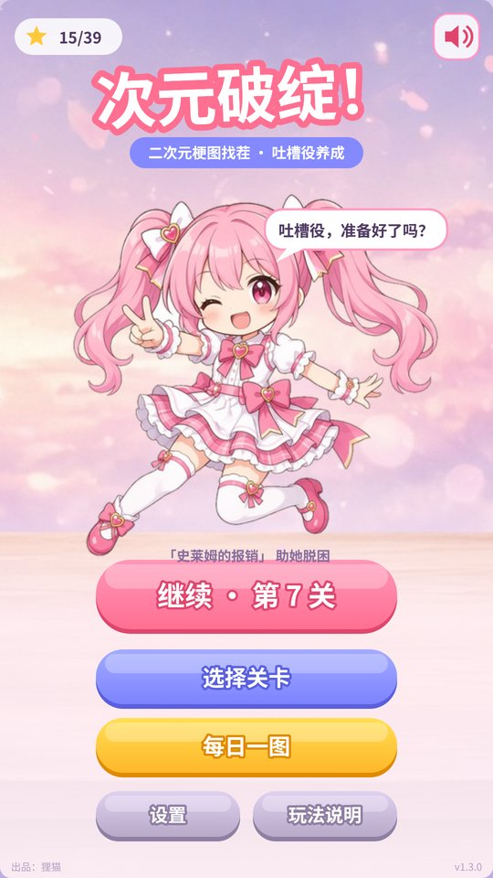
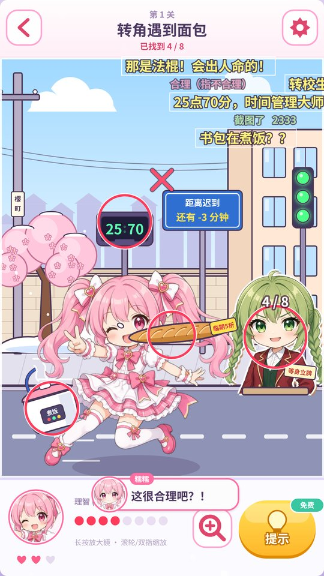
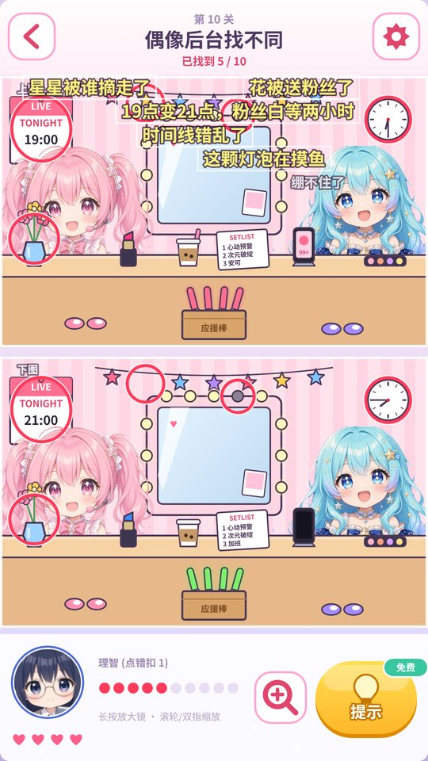
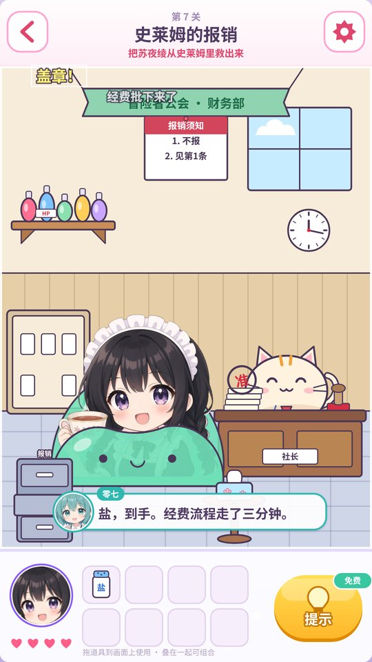

# 次元破绽！

二次元梗图找茬小游戏，13 关，免安装，下载解压就能玩。

## 下载

- **Windows 版**：[ciyuan-pozhan-windows.zip](https://github.com/limoaCatherine/anime-minigames/releases/download/pozhan-v1.3/ciyuan-pozhan-windows.zip)（159 MB）
  解压后双击 `次元破绽\次元破绽.exe`
- **网页版**：[ciyuan-pozhan-web.zip](https://github.com/limoaCatherine/anime-minigames/releases/download/pozhan-v1.3/ciyuan-pozhan-web.zip)（8.7 MB）
  解压后双击 `次元破绽-网页版\index.html`，断网也能玩

Windows 弹出「Windows 已保护你的电脑」时，点「更多信息」→「仍要运行」。

  
  
  
  

## 玩法

每关一张有问题的画面，找出所有破绽就过关，点错会扣理智。关卡类型有找不合理、找不同、助她脱困、换装和文字拼字五种，卡住了可以用提示。

## 配音署名

VOICEVOX:満別花丸 / VOICEVOX:冥鳴ひまり / VOICEVOX:四国めたん / VOICEVOX:九州そら / VOICEVOX:あんこもん

许可条款见 [docs/licenses/](docs/licenses/)。从源码构建见 [docs/开发说明.md](docs/开发说明.md)。

---

出品：狸猫
